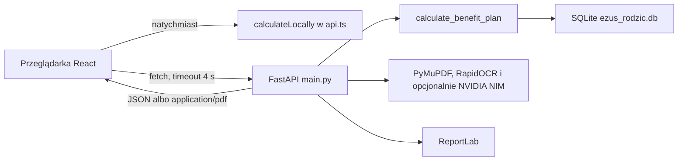

# eZUS Rodzic+ — dokumentacja techniczna

Dokument opisuje stan kodu w tym repozytorium: skąd bierze się każdy element, jak jest połączony i po co istnieje. Aplikacja jest demonstracją asystenta świadczeń rodzicielskich. Wyniki mają charakter informacyjny i nie są decyzją ZUS ani poradą prawną.

Nazwa produktu w interfejsie: **eZUS Rodzic+**, podtytuł **Asystent Świadczeń Rodzicielskich**. Pakiet npm nadal nazywa się `figma-make-app`, bo szkielet frontendu powstał w Figma Make i został nadpisany własnym widokiem.

## 1. Po co jest aplikacja

Użytkownik przechodzi przez symulowane wejście do PUE/eZUS (login.gov.pl / mObywatel), ogląda status ubezpieczenia chorobowego, liczy plan zasiłku, składa symulowane dokumenty, sprawdza wniosek PDF i widzi organizacje pomocowe.

Pięć zakładek po wejściu w aplikację:

| Id widoku | Etykieta | Po co |
| --- | --- | --- |
| `status` | Mój Status i Symulacja eZUS | Ubezpieczenie, płatnik, e-ZLA, radar ryzyk |
| `calculator` | Zintegrowany Kalkulator Zasiłków | Plan, wykres kolejności świadczeń, harmonogram, PDF planu |
| `documents` | Wnioski, Dokumenty i Terminy | ZAM, a przy nie-pracowniku także ZUR i ZAO, wniosek o urlop, odpis aktu, checklista |
| `pdf` | Weryfikator Spraw PDF | Cztery sprawy testowe albo upload PDF |
| `support` | Strefa Wsparcia i Sytuacje Trudne | Organizacje, panel stawek, panel organizacji |

Nie ma routera (`react-router`). Zakładka to stan React `view` w `frontend/src/App.tsx`. Adres w pasku przeglądarki zostaje `/`. Górna nawigacja nie ma numerów. Numery `02`, `03`, `02` i `05` są tylko na dolnych paskach „NASTĘPNY KROK” i wskazują cel, nie miejsce na liście: status prowadzi do kalkulatora, kalkulator do dokumentów, weryfikator z powrotem do kalkulatora, dokumenty do strefy wsparcia.

## 2. Mapa repozytorium

```
zppr/
├── README.md                  skrócona instrukcja uruchomienia i lista endpointów
├── DOKUMENTACJA.md            ten plik
├── docker-compose.yml         backend :8000 i frontend nginx :5173
├── .gitignore                 .venv, node_modules, __pycache__, .env, *.pyc, dist
├── backend/
│   ├── main.py                FastAPI, CORS, modele wejścia, endpointy
│   ├── engine.py              silnik świadczeń 2026 i trzy scenariusze
│   ├── database.py            SQLite: organizacje i parametry ustawowe
│   ├── pdf_verifier.py        odczyt PDF (PyMuPDF, RapidOCR, opcjonalny NVIDIA NIM) i 4 sprawy
│   ├── pdf_generator.py       PDF wychodzące (ReportLab)
│   ├── requirements.txt       zablokowane wersje Pythona
│   ├── Dockerfile             python:3.12-slim + czcionki
│   ├── tests/audit_2026.py    test regresyjny silnika, PDF i żywego API
│   └── ezus_rodzic.db         powstaje przy pierwszym starcie, nie jest w gicie
└── frontend/
    ├── index.html             szablon HTML, czcionka Inter, sloty Figma
    ├── package.json           React 19, Vite 8, Tailwind 4, TypeScript 5.7
    ├── vite.config.ts         dev server, alias @, wtyczki Figma Make
    ├── tsconfig.json          ES2020, strict, jsx react-jsx, noEmit
    ├── nginx.conf             SPA: każda ścieżka wraca do index.html
    ├── Dockerfile             build node:20-alpine, serwowanie nginx:alpine
    ├── src/main.tsx           React 19 StrictMode, montuje <App /> w #root
    ├── src/App.tsx            cały interfejs
    ├── src/api.ts             klient HTTP, typy, lustro silnika, dane offline
    ├── src/index.css          paleta, układ, RWD 900 i 520
    ├── src/vite-env.d.ts      typy import.meta.env (VITE_*)
    ├── src/assets/logo-zus-official.svg
    ├── public/favicon.svg         monogram ZUS, ikona karty przeglądarki
    └── .figma/make/site.json      tytuł karty i ścieżka ikony
```

Katalog `materialy/` trzyma PDF-y źródłowe przepisów i poradnika. Nie są importowane przez aplikację. Służą jako materiał, z którego wyprowadzono reguły w `engine.py`.

## 3. Stack — co, skąd, jak, po co

### 3.1. Frontend

| Element | Wersja w `package.json` | Skąd | Po co |
| --- | --- | --- | --- |
| React | `^19.0.0` | npm | Jeden komponent `App` i widoki funkcyjne. Brak Redux, Zustand i React Query. Stan trzyma `useState`. |
| react-dom | `^19.0.0` | npm | `createRoot` w `main.tsx`. |
| TypeScript | `^5.7.0` | npm, dev | `strict: true`, cel `ES2020`. W kodzie nie ma `String.prototype.replaceAll`, bo cel ES2020 go nie gwarantuje. |
| Vite | `^8.1.7` | npm, dev | Dev server, HMR, `npm run build` do `frontend/dist`. |
| `@vitejs/plugin-react` | `^6.0.0` | npm, dev | JSX i Fast Refresh. |
| Tailwind CSS | `^4.0.0` | npm, dev | W `index.css` jest `@import "tailwindcss"`. Większość wyglądu to własne klasy, nie utility. |
| `@tailwindcss/vite` | `^4.0.0` | npm, dev | Podpina Tailwind 4 do Vite bez `tailwind.config.js`. |
| oxfmt | `^0.76.0` | npm, dev | Skrypt `npm run format`. Nie jest częścią builda. |

Node w Dockerze: **20-alpine**. Lokalnie wystarcza Node, który umie Vite 8 (w praktyce Node 20+).

Przeglądarka nie ma osobnego serwera API po swojej stronie. `fetch` idzie wprost do FastAPI. Nie ma proxy w `vite.config.ts`.

### 3.2. Backend

| Element | Wersja | Skąd | Po co |
| --- | --- | --- | --- |
| Python lokalnie | 3.13 (venv w `backend/.venv`) | system | Uruchomienie uvicorn poza Dockerem. `rapidocr-onnxruntime==1.4.4` deklaruje Pythona poniżej 3.13, więc w tym venv wszedł z pominięciem tej deklaracji. Na obrazie 3.12 pin instaluje się wprost. |
| Python w Dockerze | `python:3.12-slim` | Docker Hub | Obraz produkcyjny. 3.12, nie 3.13, bo obraz jest lżejszy i ma stabilne koła pip. |
| FastAPI | `0.115.0` | pip | HTTP, walidacja Pydantic, `/docs` i `/openapi.json`. |
| uvicorn `[standard]` | `0.30.6` | pip | Serwer ASGI. `[standard]` dokłada `watchfiles` i `httptools`. |
| Pydantic | `2.9.2` | pip | Modele `CalculatorInput`, `LegislationInput`, `OrgCreate`. |
| python-multipart | `0.0.12` | pip | Pole `file` w `POST /api/pdf/verify`. Bez tego FastAPI nie przyjmie uploadu. |
| PyMuPDF (`fitz`) | `1.26.7` | pip | Tekst z PDF. Wersja 1.24.10 nie ma koła na Pythona 3.13. Import zostaje `import fitz`. |
| google-genai | `1.21.1` | pip | Zostaje w `requirements.txt`. Bieżący odczyt PDF go nie woła. |
| rapidocr-onnxruntime | `1.4.4` | pip | Lokalny OCR skanu, leniwie, najwyżej dwie pierwsze strony. |
| httpx | `0.28.1` | pip | Opcjonalne wywołanie NVIDIA NIM, gdy ustawiono `NVIDIA_API_KEY`. |
| ReportLab | `4.2.2` | pip | Trzy PDF-y wychodzące: plan, raport weryfikacji, checklista. |
| SQLite | biblioteka standardowa | Python | `sqlite3`. Nie ma SQLAlchemy ani Postgresa. |
| decimal | biblioteka standardowa | Python | Pieniądze w silniku: `Decimal` + `ROUND_HALF_UP` do grosza. `Decimal * float` rzuca `TypeError`, dlatego mnożniki są `Decimal`. |

### 3.3. Infrastruktura

| Element | Wersja / obraz | Po co |
| --- | --- | --- |
| Docker Compose | plik v2 bez pola `version` | Jedna komenda stawia API i frontend. |
| nginx | `nginx:alpine` | Serwuje zbudowany `dist`. Nie proxy’uje `/api`. |
| czcionki i biblioteki w obrazie API | `fonts-dejavu-core`, `fonts-liberation`, `libglib2.0-0`, `libgl1`, `libgomp1`, `libsm6`, `libxext6`, `libxrender1`, `libxcb1` | Polskie znaki w PDF oraz start RapidOCR na `python:3.12-slim`. Bez bibliotek OpenCV skan pada przy `import cv2`, choć samo API wstaje. |
| GitHub | `https://github.com/imxkamil/zppr` | Zdalne `origin`, gałąź `main`. |

### 3.4. Czego świadomie nie ma

- Brak bazy użytkowników, sesji i haseł. Logowanie mObywatel jest symulacją i zwraca stałą osobę testową.
- Brak ORMa, kolejek, Redisa i osobnego frontu na Next.js.
- Brak biblioteki wykresów. Oś czasu to flexbox w CSS.
- Brak i18n. W pasku jest napis **PL** z podpowiedzią, że tłumaczeń EN i UA nie ma. Nie ma listy, która zmienia język.
- Lokalny `.env` jest w `.gitignore` i nie jest śledzony. W `docker-compose.yml` oraz `.env.example` jest dedykowany klucz sandboxowy NVIDIA NIM jako fallback na ocenę jury. Zmienna `NVIDIA_API_KEY` go nadpisuje. Po usunięciu klucza OCR zostaje lokalny.

## 4. Jak to jest uruchamiane

### 4.1. Dwa procesy lokalnie

Backend, z katalogu `backend`:

```powershell
py -3 -m venv .venv
.\.venv\Scripts\python.exe -m pip install -r requirements.txt
.\.venv\Scripts\python.exe -m uvicorn main:app --host 127.0.0.1 --port 8000
```

`main:app` oznacza obiekt `app` w `backend/main.py`. Katalog roboczy musi być `backend`, bo importy są płaskie (`from engine import ...`), bez pakietu.

Frontend, z katalogu `frontend`:

```powershell
npm install
npm run dev
```

Vite słucha `localhost` na `PORT` albo **5173**. `strictPort: false`, więc gdy 5173 jest zajęty, Vite sam bierze następny wolny port. API wtedy trzeba wskazać ręcznie:

```powershell
$env:VITE_API_URL = "http://127.0.0.1:8000"
npm run dev -- --port 5174
```

`VITE_API_URL` jest czytane w `frontend/src/api.ts` w czasie builda i dev servera. Zmienna bez prefiksu `VITE_` nie trafi do przeglądarki.

### 4.2. Docker

Z katalogu głównego:

```bash
docker compose up --build
```

| Usługa | Obraz | Port hosta | Port w kontenerze |
| --- | --- | --- | --- |
| `backend` | budowany z `backend/Dockerfile` | 8000 | 8000 |
| `frontend` | budowany z `frontend/Dockerfile` | 5173 | 80 (nginx) |

`depends_on` czeka tylko na start kontenera backendu, nie na gotowość `/api/health`. Fallback `NVIDIA_API_KEY` w Compose to klucz sandboxowy z `.env.example`. Klon bez `.env` ma od razu uzupełnianie pustych pól. Własna zmienna środowiskowa nadpisuje ten klucz, a po jego usunięciu skan dalej czyta RapidOCR offline.

Dockerfile backendu kopiuje cały katalog `backend` (łącznie z testami, jeśli są w kontekście). Uruchamia `uvicorn main:app --host 0.0.0.0 --port 8000`. `0.0.0.0` jest konieczne, żeby port był widoczny poza kontenerem. Lokalnie można zostać przy `127.0.0.1`.

Dockerfile frontendu ma dwa etapy: `npm ci` + `npm run build`, potem nginx z `dist`. `nginx.conf` robi `try_files $uri $uri/ /index.html`, żeby odświeżenie podścieżki nie dawało 404. Aplikacja i tak nie używa podścieżek widoków.

Build Dockera **nie** ustawia `VITE_API_URL`. Zbudowany JS woła domyślne `http://localhost:8000`. To działa, gdy przeglądarka i opublikowany port API są na tej samej maszynie. Z innego komputera trzeba zbudować frontend z `VITE_API_URL` wskazującym publiczny adres API.

### 4.3. Adresy po starcie

- Interfejs: `http://localhost:5173/`
- API: `http://127.0.0.1:8000`
- Swagger: `http://127.0.0.1:8000/docs`
- OpenAPI: `http://127.0.0.1:8000/openapi.json`
- Zdrowie: `GET /api/health` → `{"status":"ok","service":"ezus-rodzic"}`

Tytuł OpenAPI: `eZUS Rodzic+ API`, wersja `1.0.0`.

## 5. Przepływ danych



Kalkulator najpierw rysuje wynik z `calculateLocally`, żeby pole nie migało pustką. Po odpowiedzi `POST /api/calculator/simulate` zastępuje go planem z Pythona. Do oceny kwot liczy się odpowiedź API. Obie ścieżki mają te same wzory, ale nie ten sam sposób grosza: podstawa w Pythonie idzie przez `Decimal` i `ROUND_HALF_UP`, miesięczna kwota w Pythonie przez wbudowane `round` (połowa do parzystej), a lustro w TypeScript przez `Math.round`. Przy kwotach z testu (8 200 zł) obie ścieżki dają 5 766,76 / 5 074,75. Różnice grosza i inne rozjazdy lustra są w sekcji 12.19.

Gdy `GET /api/scenarios` nie wróci w 4 s, stopka pokazuje „Tryb lokalny”, a widoki biorą `FALLBACK_*` z `api.ts`. Próba powtarza się co 5 s. Gdy API wstanie, scenariusze i stawki podmieniają się na dane z serwera.

## 6. Paleta kolorów

Źródło prawdy interfejsu to zmienne w `:root` w `frontend/src/index.css`. Tailwind ich nie nadpisuje. Klasy odwołują się do `var(--...)`.

### 6.1. Zmienne główne

| Zmienna | Hex | Po co |
| --- | --- | --- |
| `--green` | `#007a33` | Zieleń ZUS: przyciski główne, aktywna zakładka, kwoty, pasek postępu, pigułka „połączono” |
| `--green-dark` | `#005f27` | Hover i ciemniejszy zielony akcent |
| `--navy` | `#0b2545` | Pasek instytucji, nagłówki, tekst mocny |
| `--blue` | `#1d4ed8` | Obrys fokusu (`outline-color`) |
| `--canvas` | `#f8fafc` | Tło strony |
| `--surface` | `#fff` | Karty i panele |
| `--line` | `#e2e8f0` | Ramki i separatory |
| `--text` | `#172033` | Tekst podstawowy |
| `--muted` | `#627083` | Podpisy, etykiety pól, tekst pomocniczy |
| `--success` | `#15803d` | Odznaka „ok” |
| `--success-bg` | `#dcfce7` | Tło odznaki sukcesu |
| `--warning` | `#a65306` | Odznaka ostrzeżenia |
| `--warning-bg` | `#fef3c7` | Tło ostrzeżenia |
| `--danger` | `#b91c1c` | Błąd, kasowanie organizacji |
| `--danger-bg` | `#fee2e2` | Tło błędu |
| `--info` | `#1e40af` | Odznaka informacyjna, linki w stopce |
| `--info-bg` | `#dbeafe` | Tło informacji, ramka popovera AI (`#bfdbfe` jest jaśniejszym wariantem tej rodziny) |

### 6.2. Kolory wpisane wprost w CSS

Nie wszystko idzie przez zmienne. Te heksy są w `index.css` celowo, przy drobnych elementach:

| Hex | Gdzie |
| --- | --- |
| `#f1f5f9` | Tło ikony w nawigacji, gdy zakładka nie jest aktywna |
| `#94a3b8` | Numer kroku w nawigacji, skala osi czasu |
| `#cbd5e1` | Ramka zakładek scenariusza, kreska skali, górna kreska belki mobilnej |
| `#64748b` | Tekst nieaktywnej zakładki i ikona w polu |
| `#dbe3eb` | Przerywana ramka pustego odcinka osi |
| `#202a35` | Tekst strony login.gov.pl |
| `#f5f6f7` | Tło strony login.gov.pl (osobne od `--canvas`, żeby ekran logowania wyglądał jak gov.pl, nie jak panel ZUS) |
| `#ffec00` | W trybie kontrastowym: tło przycisku logowania, tekst czarny |
| `#111` nie występuje w palecie aplikacji | — |

Cień popovera AI: `rgb(15 23 42 / 16%)`. Cień belki mobilnej: `rgb(15 23 42 / 10%)`. Tło modala: `rgb(11 37 69 / 60%)`, czyli `--navy` z przezroczystością, plus `backdrop-filter: blur(2px)`.

### 6.3. Wykres kolejności świadczeń

Paski leżą absolutnie w `.timeline-track`. Kolory są klasami, nie zmiennymi: `full` `#0f766e` (100%), `maternity` to `--green`, `parental` `#3b9c66`, `father` `--blue` (70%), `reduced` `#b45309` (praca w trakcie urlopu). Kreska porodu `.birth-mark` ma 2 px i kolor `--navy`. Pusty tor ma tło `#f8fafc` i przerywaną ramkę `#dbe3eb`. Legenda pokazuje tylko te tony, które są na wykresie. Skąd bierze się pozycja paska, jest w sekcji 12.18.

### 6.4. Wersja kontrastowa

Przycisk „Wersja kontrastowa” dodaje klasę `high-contrast` na `.app`. Podmienia:

- `--canvas`, `--surface` → `#000`
- `--line`, `--text`, `--muted` → `#fff`
- przycisk główny i login → tło `#ffec00`, tekst `#000`

Reszta komponentów dziedziczy zmienne, więc karty i tekst jadą na czarno-biało bez drugiej palety.

### 6.5. PDF wychodzący

`backend/pdf_generator.py` ma własną paletę ReportLab, zbliżoną do UI, ale nie identyczną (druk na białej kartce A4):

| Nazwa | Hex | Odpowiednik w UI |
| --- | --- | --- |
| `NAVY` | `#0b2545` | `--navy` |
| `GREEN` | `#007a33` | `--green` |
| `AMBER` | `#9a6700` | ciemniejszy niż `--warning` `#a65306`, czytelniejszy w druku |
| `RED` | `#9f1239` | osobny od `--danger` `#b91c1c` |
| `MUTED` | `#5b6b7c` | blisko `--muted` `#627083` |
| `LINE` | `#d7dee7` | jaśniejsza kreska tabeli |
| `ZEBRA` | `#f4f7fb` | co drugi wiersz |
| `PAPER` | `#f7faf8` | tło kafelka KPI |
| tekst tabeli | `#1f2937` | akapit `body` |

### 6.6. Skala pisma i krój

`index.html` ładuje **Inter** z Google Fonts, grubości 400, 500, 600, 700, 800:

`https://fonts.googleapis.com/css2?family=Inter:wght@400;500;600;700;800&display=swap`

`body` używa `"Inter", "Segoe UI", sans-serif`. Seoe UI jest zapasem offline na Windowsie. `login-gov-page` wymusza samo Inter.

Przyciski A− / A / A+ ustawiają `fontSize` na `.app`:

- A− → `0.94rem`
- A → `1rem`
- A+ → `1.06rem`

Prawie wszystkie rozmiary w CSS są w `rem`, więc cała skala jedzie z tym jednym suwakiem. Wyjątki w `px` to ramki, cienie i stałe wysokości pasków (72, 64, 58 px).

W PDF, gdy jest plik TTF, krojem jest Arial (Windows: `C:\Windows\Fonts\arial.ttf` i `arialbd.ttf`), potem DejaVu Sans, potem Liberation Sans. Nazwy zarejestrowane w ReportLab: `EzSans` i `EzSans-Bold`. Gdy żadnej pary nie ma, zostaje Helvetica, a polskie znaki są zrzucane do ASCII (`ą→a`, `ł→l` itd.) funkcją `_esc`. Docker instaluje DejaVu i Liberation właśnie po to, żeby ta ścieżka Helvetica nie włączyła się w kontenerze.

## 7. Układ, responsywność, dostępność

Szerokość treści: `.shell { width: min(1320px, calc(100% - 64px)); margin: 0 auto; }`.

Dwa progi, oba w `index.css`:

**Do 900 px**

- shell zwęża się do `min(100% - 32px, 720px)`
- pasek instytucji 64 px, znika dopisek instytucji i etykieta „symulacja”
- pasek użytkownika 68 px. Selecta „Scenariusz testowy” nie ma już na żadnej szerokości. Zostaje imię i pastylka połączenia; tutaj pastylka chowa tekst i zostawia ikonę
- nawigacja przewija się w poziomie, widać skrót `.nav-short` (Mój status, Kalkulator, Dokumenty, Weryfikator PDF, Wsparcie), znika długa etykieta. Numerów na zakładkach nie ma na żadnej szerokości
- pasek postępu `.progress-mobile` (3 px, zieleń) pokazuje `(indeks + 1) / 5`. Dokumenty są trzecią zakładką, więc mają około 60% szerokości. Weryfikator jest czwarty
- kalkulator, dashboard i weryfikator spadają do jednej kolumny
- siatki ryzyk i organizacji: 2 kolumny
- chipy spraw PDF: 2 kolumny

**Do 520 px**

- shell `calc(100% - 28px)`
- pasek 58 px, przyciski górne chowają tekst i zostawiają ikonę (`font-size: 0`)
- zakładki zdarzenia (poród / ciąża / adopcja / piecza) w jednej kolumnie
- `.two-fields` i `.triple-fields` w jednej kolumnie
- wykres: paski mają `min-width: 0`, awatary rodziców chowają się, skala `.timeline-scale` zaczyna się od 64 px (na szerokim ekranie od 128 px)
- tabela wypłat przestaje być tabelą wizualnie: `thead` jest przycięty dla czytników, każdy `td` jest wierszem `flex` z etykietą z `data-label` (`td::before { content: attr(data-label) }`). Dzięki temu strona nie dostaje poziomego scrolla
- na dole wjeżdża `.mobile-summary`: `position: fixed`, wysokość 67 px, `z-index: 50`, netto miesiąca i przycisk „Zmień dane” (scroll na górę formularza)

Skip link „Przejdź do treści” wskazuje `#main-content`. Figma w `site.json` ma `addBypassLinks: false` i `robots.index: false` (`noindex`). Własny skip link jest w nagłówku aplikacji, nie w szablonie Figma.

Przyciski **A− / A / A+** ustawiają `fontScale` na 0,875, 1 i 1,125. Aktywny ma klasę `active` i `aria-pressed`. Efekt w `App` zapisuje `document.documentElement.style.fontSize` jako `${fontScale * 100}%`, bo rozmiar na `.app` nie zmienia `rem`. Po odmontowaniu rozmiar wraca do pustego. Domyślnie wciśnięte jest A, czyli 16 px na `html`.

`frontend/.figma/make/site.json` ustawia tytuł karty na dokładnie `ZUS - Świadczenia rodzicielskie` i ikonę `/favicon.svg`. Wtyczka w `vite.config.ts` wstawia ten tytuł w miejsce komentarza `<!-- figma:title -->` w `index.html` i dokłada `<link rel="icon" href="/favicon.svg">`. Gdyby `site.json` nie miał tytułu, ten sam tekst jest zapasem w `vite.config.ts` (`config.title ?? "ZUS - Świadczenia rodzicielskie"`). `favicon.svg` to zielony monogram ZUS wycięty z `logo-zus-official.svg`, bo pełny napis jest nieczytelny w 16 px. Nazwa produktu na ekranie zostaje „eZUS Rodzic+”.

## 8. Frontend — pliki i stan

### 8.1. `main.tsx`

Montuje `<App />` w `#root` wewnątrz `React.StrictMode`. StrictMode w developmencie odpala efekty dwa razy. Pobranie scenariuszy jest na to odporne (`cancelled` w cleanup).

### 8.2. `App.tsx`

Jeden plik, bez podziału na katalog `components/`. Kolejność logiczna:

1. Ikony SVG jako mapa `icons` (brak osobnej biblioteki ikon).
2. `Badge`, `Button`, `SectionHeader`, `PageIntro`.
3. `AiInfo` / `AiExplainer` — modal „Jak działa AI w tym module?”. Dwa warianty: `risks` i `pdf`.
4. `StatusView`. Brew: „Twój profil”. Sekcja ryzyk ma brew „Ważne informacje”.
5. `CalculatorView`. Brew: „Kalkulator świadczeń”. Formularz (`calcForm`) żyje w `App` i przeżywa zmianę zakładki.
6. `DocumentsView` i `DocumentWizard`. Brew: „Dokumenty i terminy”. Wizard: `zam`, `leave`, `birth`, `attachment`. Nazwy załączników i status „WYSŁANO” żyją w `App`. Zapytania do PUE z tej zakładki nie ma: zostaje pastylka w pasku użytkownika.
7. `PdfView`. Brew: „Weryfikacja dokumentów”. Tytuł zakładki to „Weryfikator Spraw PDF”, bez dopisku „(Test ZUS)”. Po sparsowaniu woła `onParsed`, a `App` trzyma `pdfCase`. W karcie rozstrzygnięcia jest tylko „Pobierz raport”. „Przenieś dane do kalkulatora i policz” jest wyłącznie na dolnym pasku.
8. `SupportView` i `AdminPanel`. Brew źródłowa to „STREFA WSPARCIA”; CSS i tak zamienia brew na wielkie litery. Panel edytuje stawki i organizacje.
9. `PortalEntry`, `LoginGov`, `QrCode`, `Authenticating`, `PueInquiry`.
10. Domyślny `App` spina auth, scenariusz, skalę pisma, kontrast, język i widok.

Stan w `App`:

| Stan | Start | Po co |
| --- | --- | --- |
| `view` | `status` | która zakładka |
| `scenarios` | `FALLBACK_SCENARIOS` | podmiana po `GET /api/scenarios` |
| `scenarioId` | `uop_over_20` | aktywna persona |
| `fontScale` | `1` | A− 0,875 / A 1 / A+ 1,125, zapis na `html` |
| `contrast` | `false` | klasa `high-contrast` |
| język | stałe `PL` | napis w pasku, bez listy EN/UA |
| `authStep` | `portal-entry` | bramka, login, „logowanie”, panel |
| `authUser` | `null` | odpowiedź symulacji mObywatel |
| `previewMode` | `false` | wejście bez logowania: parametry wariantu, bez danych osoby |
| `apiOnline` | `null` | `true` / `false` do stopki |
| `legislation` | `FALLBACK_LEGISLATION` | stawki z SQLite albo domyślne |
| `pueOpen` | `false` | modal zapytania PUE |
| `pdfCase` | `null` | ostatni wynik weryfikatora, do importu w kalkulatorze |
| `calcForm` | formularz scenariusza | dane kalkulatora; zmiana kasuje załączniki i „WYSŁANO” |
| `checklistFiles` | `{}` | nazwy plików checklisty; zostają przy zmianie zakładki |
| `checklistSent` | same `false` | „WYSŁANO” / „WNIOSEK ZŁOŻONY” z kreatora |

Są dwa wejścia i nie mieszają danych osoby.

**Bez logowania** (`previewMode && !authUser`). Prawy róg nagłówka to status „Tryb bez logowania (podgląd)”, przycisk „Zaloguj przez mObywatel” (ekran login.gov.pl) i link „Zmień tryb / wróć na start”. Nie ma awatara, inicjałów ani „Wyloguj”. Pasek pod nagłówkiem ma ikonę kalkulatora i tytuł wariantu: „Symulacja bez logowania · Pracownik UoP (> 20 os.)”, „· Działalność gospodarcza (JDG)” albo „· Umowa zlecenie (< 90 dni chorobowego)”. Preset w kalkulatorze albo import PDF zmienia tylko dalszą część na „Aktywny preset: …”. Nazwisko z presetu albo z pliku nie wchodzi na pasek. Pastylka po prawej mówi „Bez konta PUE”.

**Po mObywatelu** (`authUser`). Pasek i nagłówek zostają jak dotychczas: Anna Kowalska, inicjały AK, PESEL `920514*****` i „Wyloguj”. Pastylka po prawej, przycisk na statusie, we wnioskach, w strefie wsparcia oraz nagłówek i przycisk wysłania w modalu nazywają się tak samo: „Wyślij zapytanie do PUE/eZUS”. Na zakładce kalkulatora aktywny preset nadpisuje imię na pasku dopiskiem „Aktywny preset: …”. Gdy presetu nie ma, a weryfikator oddał już dokument z nazwiskiem, pasek pokazuje to nazwisko i „Dokument: …”.

Po wejściu na status zalogowany użytkownik widzi od razu nazwy kart. Wartości (status ubezpieczenia, wyczekiwanie, płatnik, saldo, podstawa składek, e-ZLA, radar) przez 3500 ms są szkieletem z komunikatem pobierania z KSI ZUS i e-ZLA. Potem baner robi się zielony: „Dane pobrane z KSI ZUS i rejestru e-ZLA (aktualne na dzień symulacji)”. „Odśwież dane z ZUS” powtarza te 3,5 s. Zmiana `scenario.id` też je powtarza. W podglądzie bez logowania tego czekania nie ma.

Harmonogram nie bierze imienia z paska. Bierze `plan.parents` z silnika. Puste pole daje etykietę roli („Matka”, „Ojciec”), nie Annę.

### 8.3. Wejście

1. **Portal.** Trzy karty scenariuszy albo „Zaloguj do PUE/eZUS przez mObywatel”. Karta logowania ma przycisk „Symuluj logowanie przez login.gov.pl (mObywatel)” i zdanie, że to lokalna symulacja Węzła Krajowego, bez przejścia na zewnętrzną domenę.
2. **login.gov.pl.** Ekran stylizowany na Węzeł Krajowy, z jawną informacją, że zostaje lokalną symulacją demonstracyjną. `POST /api/auth/mobywatel/init` daje `session_id` i `qr_payload` ważny 300 s. Przycisk skanu woła `POST /api/auth/mobywatel/confirm/{session_id}`.
3. **Authenticating.** Krótki ekran przejściowy, potem panel.
4. **Podgląd bez logowania.** `enterPreview` ustawia `previewMode`, czyści `authUser` i otwiera status wybranego wariantu. Nie woła confirm i nie pokazuje Anny Kowalskiej. Nagłówek statusu to „Symulacja uprawnień:” plus etykieta wariantu (bez numeru z listy). Nad kartami jest baner z przyciskiem „Zaloguj przez mObywatel →”. Karty mają rodzaj ubezpieczenia, wyczekiwanie, płatnika, przykładowe e-ZLA i radar ryzyk. Nie ma imienia, nazwiska ani PESEL.

5. **Konto po mObywatelu.** `confirm` zawsze zwraca Annę Kowalską, PESEL zamaskowany `920514*****`, `provider: "Węzeł Krajowy (mObywatel 2.0)"`. To fixture symulacji, nie odczyt z mObywatela. Pusty `session_id` daje HTTP 400. Wtedy status wita „Dzień dobry, Anna”, a nagłówek ma AK i „Wyloguj”. Karty statusu przez 3,5 s pokazują same etykiety i szkielet pobierania z KSI ZUS. Podgląd bez logowania pokazuje wartości od razu.

„Zmień tryb / wróć na start” i „Wyloguj” wracają na bramkę, czyszczą użytkownika, tryb podglądu i plan wniosku. Widok wraca na `status`.

### 8.4. Kalkulator — pola formularza

`CalculatorView` wysyła do API obiekt zgodny z `CalculatorInput`:

| Pole UI | Klucz JSON | Uwagi |
| --- | --- | --- |
| Rodzaj świadczenia | `benefit_type` | `porod`, `ciaza_l4`, `adopcja`, `piecza` |
| Forma zatrudnienia | `employment_type` | `uop`, `zlecenie`, `jdg`, `ustanie` |
| Liczba dzieci | `children_count` | 1–5 |
| Imię wnioskodawcy | `parent_name` | ze scenariusza albo z PDF |
| Drugi rodzic | `second_parent_name` | puste → silnik wstawia „Ojciec” / „Matka” / „Drugi rodzic” |
| Rola | `parent_role` | `matka`, `ojciec`, `opiekun` |
| Data | `due_date` | ISO `RRRR-MM-DD`. Puste = brak prawa, komunikat o dacie |
| Tygodnie przed porodem | `tygodnie_przed_porodem` | suwak 0–6, tylko poród |
| Tydzień ciąży, masa, dni | `tydzien_ciazy_porodu`, `masa_urodzeniowa_g`, `dni_w_szpitalu` | uzupełniający urlop |
| Pobyt od / do dnia życia | `hospitalizacja_od_dnia`, `hospitalizacja_do_dnia` | okno 5–28 przy ≥ 37 tyg. |
| Za życiem | `za_zyciem` | wydłuża rodzicielski |
| Urlop ojcowski | `include_paternity` | domyślnie włączony |
| Matka nie może opiekować | `matka_nie_moze_opiekowac` | bez osobnego akapitu pod przełącznikiem. Włączony przełącznik przenosi na wykresie blok po porodzie do ojca. Urlop przed porodem zostaje przy matce |
| Wariant | `variant` | `81.5` albo drugi, mapowany na `100_70` |
| Tygodnie łączenia | `tygodnie_laczenia` | aktywne, gdy etat w pracy podczas urlopu jest większy od 0 |
| Liczba ubezpieczonych | `liczba_ubezpieczonych` | liczba, tylko UoP i zlecenie. Progu nie wybiera się z osobnej listy |
| Etat w umowie | `wymiar_etatu` | 1 / 0,75 / 0,5 / 0,25, tylko UoP, zaraz pod formą zatrudnienia |
| Etat w pracy podczas urlopu | `etat_pracy` | 0–0,5, tylko UoP. To nie jest etat z umowy |
| Brutto | `base_salary_gross` | **przed** odjęciem 13,71% |
| Wiek dziecka | `wiek_dziecka_lata`, `wiek_dziecka_miesiace` | adopcja, piecza, ojcowski |
| Odroczenie szkoły | `odroczenie_obowiazku_szkolnego` | piecza do 10 lat |
| Wiek ubezpieczonego, dni L4, miesiące rehab. | `wiek_ubezpieczonego`, `dni_niezdolnosci`, `miesiace_rehabilitacji`, `rehabilitacja_w_ciazy` | zdarzenie ciąża |
| Dni wyczekiwania, dług | `waiting_days`, `debt_amount` | JDG i zlecenie |

Nad polami jest lista **Scenariusz demonstracyjny (presety 2026)**. Zamknięta lista pokazuje „Wybierz z listy”: opcja ma `value=""`, `disabled` i `hidden`, więc Chromium nie wstawia jej do otwartej listy. Startowe `activePresetId` to `""`. Wybór woła `applyDemo` i wypełnia formularz jednym z dziewięciu przypadków z `DEMO_PRESETS`, potem ten sam `useEffect` co przy ręcznej edycji woła `POST /api/calculator/simulate`. Pod listą jest jedno zdanie `hint`, bez punktów „Dane / Podział / Długość / Gdzie widać”. Etykiety presetów to pierwsze człony, bez procentów i kwot: „1. Standard UoP”, „2. JDG (przedsiębiorca)”, „3. Sufit podstawy JDG / Zlecenie”, „4. Niski wymiar etatu”, „5. Łączenie urlopu rodzicielskiego z pracą”, „6. Wcześniactwo i hospitalizacja noworodka”, „7. Urlop macierzyński przed porodem”, „8. Adopcja dziecka”, „9. Ciąża L4 i świadczenie rehabilitacyjne”. Ten sam tekst idzie do dopisku „Aktywny preset: …”. Liczby widać w polach, na kafelkach i na wykresie. Preset nie rusza parsera PDF. Górny pasek nie ma listy „Scenariusz testowy” — trzy persony (UoP, JDG, zlecenie) wybiera się na ekranie startowym. Przycisk **Wyczyść / Resetuj formularz** zdejmuje preset i zostawia parametry wariantu (podstawa, zatrudnienie, data). W trybie bez logowania pole imienia zostaje puste, z placeholderem „Wpisz imię i nazwisko lub wybierz preset...”. Po zalogowaniu reset wpisuje imię z konta (Anna). Ręczna edycja pola po presecie nie gasi zdania pod listą.

Kolejność pól po liście: rodzaj świadczenia, liczba dzieci, imiona, rola i data, wiek, forma zatrudnienia, etat w umowie (tylko UoP), brutto, liczba ubezpieczonych (UoP albo zlecenie), zadłużenie (JDG albo zlecenie), potem zwijane: urlop przed porodem, szpital, ciąża, przełączniki, wariant i łączenie z pracą. „Etat w umowie” i „Etat w pracy podczas urlopu” to dwa różne fakty. Drugi jest suwakiem w sekcji łączenia i pokazuje „N etatu”. JDG chowa etat umowy i całą sekcję łączenia. Nie ma drugiego selecta „wielkość płatnika”.

Wykres po prawej nazywa się „Kolejność świadczeń”. Zdanie pod tytułem jest złożone z tych samych pasków co rysunek. Urlop ojcowski zaczyna się w tygodniu porodu i może nachodzić na macierzyński. Urlop przed porodem jest osobnym blokiem 100% przed kreską porodu. Szpital, obniżona stawka za pracę i wydłużenie są osobnymi paskami. Wyłączne 9 tygodni ojca ma etykietę „Dla ojca”, żeby wąski pasek się zmieścił. Notatki silnika o 14 tygodniach matki, o 9 tygodniach po 70% i o urlopie przed porodem są odfiltrowane wyrażeniem `CHART_NOTES`, bo żywe API skleja je czasem w jeden napis. Szczegóły geometrii są w sekcji 12.18.

Przycisk **Importuj z symulacji ZUS / PDF** kopiuje pola tylko z `pdfCase` przekazanego z zakładki weryfikatora. Gdy `pdfCase` jest `null` (użytkownik nie otworzył weryfikatora i nic nie wgrał), formularz się nie zmienia i pojawia się komunikat, że kwota nie jest brana ze scenariusza. Import PDF nie podmienia persony sam z siebie. Otwarcie zakładki PDF publikuje od razu pierwszą sprawę fixture, więc import **po** wejściu w tę zakładkę wczyta tę sprawę, a import **przed** wejściem zostawia formularz.

„Pobierz PDF” woła `POST /api/export/calculator-pdf` i zapisuje `plan-swiadczen.pdf`. Gdy API nie odpowie, otwiera się podgląd wydruku przeglądarki.

Wartości, które mają być widoczne na ekranie, oraz lista kontrolna GUI i trzech szerokości są w sekcji 19. Wzory tych liczb są w sekcji 12.

### 8.5. `api.ts`

`API_BASE = (import.meta.env.VITE_API_URL || "http://localhost:8000").replace(/\/$/, "")`.

Końcowy ukośnik jest ścinany, żeby nie powstało `//api`.

`request()` ma timeout **4000 ms** (`AbortController`). Sieć, timeout i HTTP inny niż 2xx dają `null`. Widok wtedy zostaje przy danych lokalnych. Wyjątki, które zwracają strukturę zamiast `null`: tworzenie organizacji, zapis stawek, usuwanie organizacji, pobieranie PDF (`downloadPdf` zwraca `boolean`).

`SIMULATION_AS_OF = "2026-06-12"` to data „stanu na” w demo, nie data porodu. Data porodu w scenariuszach to **2026-09-18**.

## 9. CORS

Konfiguracja jest w `backend/main.py`, middleware `CORSMiddleware` ze Starlette:

```python
app.add_middleware(
    CORSMiddleware,
    allow_origins=["*"],
    allow_credentials=False,
    allow_methods=["*"],
    allow_headers=["*"],
    expose_headers=["Content-Disposition"],
)
```

Po co każdy przełącznik:

- **`allow_origins=["*"]`** — frontend na 5173, 5174 albo innym porcie Vite może wołać API na 8000/8001. Przeglądarka przy żądaniu „nieprostym” (JSON `POST`, `PUT`, upload) najpierw wysyła `OPTIONS`. Middleware odpowiada `Access-Control-Allow-Origin: *`.
- **`allow_credentials=False`** — specyfikacja CORS zabrania pary `Allow-Origin: *` i `Allow-Credentials: true`. Przeglądarka taką odpowiedź odrzuca, a część wersji Starlette w ogóle nie wstaje z taką konfiguracją. Aplikacja nie wysyła ciasteczek sesji, więc credentials nie są potrzebne.
- **`allow_methods=["*"]`** — GET, POST, PUT, DELETE, OPTIONS.
- **`allow_headers=["*"]`** — w tym `Content-Type: application/json` i multipart.
- **`expose_headers=["Content-Disposition"]`** — bez tego JS nie przeczyta nazwy pliku z nagłówka przy pobieraniu PDF. Domyślnie CORS eksponuje tylko „proste” nagłówki.

Nie ma allowlisty konkretnych originów. To jest świadomy wybór demonstracji, nie konfiguracja produkcyjna ZUS. Na publicznym serwerze listę originów trzeba zawęzić i wtedy można rozważyć credentials.

Preflight z przeglądarki na `http://127.0.0.1:5174` do API został sprawdzony w `tests/audit_2026.py` (test „preflight CORS” i „CORS z frontendu”).

## 10. Endpointy

Wszystkie ścieżki aplikacji są pod `/api`. `/docs`, `/redoc` i `/openapi.json` dokłada FastAPI.

### 10.1. Zdrowie

`GET /api/health` → `{"status":"ok","service":"ezus-rodzic"}`.

Przy starcie `@app.on_event("startup")` woła `init_db()`.

### 10.2. Auth (symulacja)

`POST /api/auth/mobywatel/init`  
Odpowiedź: `session_id` (UUID4), `qr_payload` w postaci `mobywatel://login.gov.pl/ezus?session=...`, `expires_in_seconds: 300`. Sesja nie jest zapisywana. Każde UUID przejdzie confirm.

`POST /api/auth/mobywatel/confirm/{session_id}`  
Pusty identyfikator: 400. Inaczej stały użytkownik Anna Kowalska.

### 10.3. Scenariusze

`GET /api/scenarios` — lista trzech rekordów z `engine.SCENARIOS`, każdy z doklejonym `legislation` i `benefit_rules` z SQLite.

`GET /api/scenarios/{scenario_id}` — jeden scenariusz albo 404 „Nieznany scenariusz”.

Identyfikatory:

| Id | Kto | Brutto w scenariuszu | Płatnik w karcie | Wyczekiwanie |
| --- | --- | --- | --- | --- |
| `uop_over_20` | Anna Kowalska, UoP od 14.02.2022 | 8 200,00 | Pracodawca, > 20 | spełnione, min. 30 dni |
| `jdg_active` | Anna Kowalska (JDG), chorobowe od 01.01.2024 | 6 500,00 | ZUS | spełnione, min. 90 dni |
| `zlecenie_no_waiting` | Anna Kowalska (Zlecenie), od 01.08.2026 | 5 400,00 | ZUS, < 20 | brak 90 dni na L4; macierzyński od 1. dnia |

Te imiona i kwoty są **jawnymi personami demo**. Nie są cichym podstawieniem, gdy parser PDF nic nie odczyta.

Każdy scenariusz ma też `ezla` (okres, dni z 270, kod B) i trzy karty `risks` (`warning` / `info` / `ok`). Radar nie woła modelu. Teksty są w `SCENARIOS`.

### 10.4. Parametry ustawowe

`GET /api/admin/params` — wiersz `id = 1` z `legislation_params`.

`PUT /api/admin/params` — body `LegislationInput`. Walidacja zakresów, potem `UPDATE`. Poza zakresem: 400 z nazwą pola.

| Pole | Domyślnie | Zakres PUT |
| --- | --- | --- |
| `rate_single_variant` | 81,5 | 1–100 |
| `rate_maternity` | 100 | 1–100 |
| `rate_parental` | 70 | 1–100 |
| `maternity_weeks_single` | 20 | 1–52 |
| `parental_weeks_single` | 41 | 1–80 |
| `paternity_weeks` | 2 | 0–12 |
| `deadline_days_81_5` | 21 | 1–90 |

`POST /api/admin/params/reset` kasuje wiersz i wstawia domyślne 2026. Po eksperymencie na demie warto to wywołać, żeby kalkulator wrócił do 81,5% i 20 + 41 tygodni.

Zmiana tych siedmiu pól przesuwa stawki wariantu, bazowe tygodnie przy jednym dziecku, ojcowskie i termin wniosku. **Nie** rusza 13,71%, płacy minimalnej, sufitu 23 550 zł, progu 20 ubezpieczonych, 1 000 zł, 9 tygodni nieprzenoszalnych, widełek szpitala ani limitów wieku. Te są stałymi w `engine.py`, bo nie są „suwakiem stawki”, tylko regułą ustawy.

Wymiary przy większej liczbie dzieci są pochodną bazy z SQLite: różnica względem 20 (macierzyński) i 41 (rodzicielski) jest dodawana do siatki 31/33/35/37 i do 65/67 przy „Za życiem”. Dzięki temu suwak w panelu nie rozjeżdża bliźniąt względem jednego dziecka.

### 10.5. Kalkulator

`POST /api/calculator/simulate`  
Body: `CalculatorInput` (domyślne w `main.py`: puste nazwisko, pusta data, podstawa 0, `liczba_ubezpieczonych` 21, wariant `81.5`, rola `matka`).  
Odpowiedź: słownik z `calculate_benefit_plan`. Błąd silnika: 400 „Nie udało się wyliczyć świadczenia…”.

Najważniejsze pola odpowiedzi:

| Pole | Znaczenie |
| --- | --- |
| `monthly_gross`, `monthly_net` | miesiąc przy stawce pokazywanej na kafelku |
| `uplift_applied` | czy zadziałało podwyższenie do 1 000 zł |
| `benefit_base` | podstawa po 13,71% |
| `declared_gross` | brutto po podłodze / suficie, przed 13,71% |
| `entitled`, `denial_reason` | odmowa (brak daty, dług, 90 dni przy L4) |
| `total_weeks`, `total_extra_days` | suma opieki |
| `payer` | tytuł, `is_zus`, `required_forms`, notatka |
| `parents` | `mother`, `father`, `role` |
| `breakdown` | tygodnie: przed porodem, macierzyński, matka, 9 tyg. ojca, ojcowski, szpital, wydłużenie |
| `schedule` | wiersze miesiąca: rodzic, rodzaj, stawka, kwota, dni |
| `deadline_21_days` | data + `deadline_days_81_5` |
| `pregnancy` | tylko przy `ciaza_l4`: dni pracodawcy, ZUS, rehab, limit 270 |
| `notes` | zdania uzasadnienia |
| `legislation` | kopia stawek użytych w tym liczeniu |

### 10.6. PDF

`GET /api/pdf/test-cases` — cztery sprawy z `TEST_CASES` (nie parsują pliku).

`POST /api/pdf/verify` — `multipart/form-data`, pole `file`. Odrzuca rozszerzenie inne niż `.pdf` i pusty plik (400). Uszkodzony PDF: 400 „Nie udało się odczytać pliku PDF.”

`POST /api/export/calculator-pdf` — liczy plan i zwraca `application/pdf`, plik `plan-swiadczen.pdf`.

`POST /api/export/verification-pdf` — PDF z już policzonego wyniku weryfikacji, `raport-weryfikacji.pdf`.

`POST /api/export/checklist-pdf` — body `{ "scenario_id": "..." }`. Nieznany id: 404. Plik checklisty zależy od płatnika scenariusza.

Wszystkie trzy odpowiedzi idą przez `pdf_attachment`: `Content-Disposition: attachment; filename="..."`. Ten nagłówek jest na liście `expose_headers`.

### 10.7. Organizacje

`GET /api/support/organizations?q=` — `LIKE` po nazwie, opisie i badge. Puste `q` zwraca wszystko, `ORDER BY id`.

`POST /api/support/organizations` — `category`, `badge`, `name`, `description`, `phone`, `website`. Pusta nazwa lub telefon: 400. Nowa organizacja dostaje `verified = 1`.

`DELETE /api/support/organizations/{org_id}` — 404, gdy nie ma wiersza. Inaczej `{ "deleted": true, "id": ... }`.

Startowa trójka, wstawiana gdy tabela jest pusta. Przy każdym `init_db()` telefony tych trzech nazw są aktualizowane także w już istniejącym pliku `ezus_rodzic.db` (`UPDATE ... WHERE name = ?`). Te same napisy są w `FALLBACK_ORGANIZATIONS`. Karta w Strefie Wsparcia dzieli telefon po `/` i składa `tel:` z samego numeru, bez dopisku „wew.”.

| Kategoria | Badge | Nazwa | Telefon |
| --- | --- | --- | --- |
| `strata` | STRATA I ŻAŁOBA | Fundacja Ernesta | 22 350 00 50 (wew. 1) |
| `wczesniactwo` | WCZEŚNIACTWO | Fundacja Wcześniak | +48 22 121 80 55 |
| `za_zyciem` | WSPARCIE RODZINY | Fundacja Dajemy Dzieciom Siłę | 116 111 (dzieci i młodzież) / 800 100 100 (rodzice i opiekunowie) |

## 11. Baza SQLite

Plik: `backend/ezus_rodzic.db`, obok `database.py`. Nie jest w gicie. Powstaje przy `init_db()`.

Połączenie owija klasa `_Connection`: `timeout=10`, `row_factory=sqlite3.Row`, commit przy wyjściu z `with`, rollback przy wyjątku, **zawsze `close()`**. Na Windowsie otwarty uchwyt SQLite blokuje podmianę pliku i reload. Dlatego nie ma globalnego połączenia.

Dwie tabele:

`organizations` — `id` AUTOINCREMENT, `category`, `badge`, `name`, `description`, `phone`, `website`, `verified` (domyślnie 1). Seed trzech fundacji dopisuje wiersze tylko przy pustej tabeli, a numer telefonu dopisuje od nowa przy każdym starcie, po nazwie organizacji.

`legislation_params` — dokładnie jeden wiersz, `id INTEGER PRIMARY KEY CHECK (id = 1)`, siedem kolumn z sekcji 10.4.

`update` robi merge z bieżącym wierszem. `reset` robi `DELETE` i insert domyślnych. Brak wiersza przy odczycie wstawia domyślne.

## 12. Silnik `calculate_benefit_plan`

Plik: `backend/engine.py`. Jedno wejście: słownik (to, co Pydantic zrzucił `model_dump()`). Jedno wyjście: plan z sekcji 10.5. Lustro tych samych wzorów jest w `calculateLocally` w `frontend/src/api.ts`. Kafelek na ekranie po powrocie żądania pokazuje liczby z Pythona. Sekcja 12.19 wymienia miejsca, w których lustro liczy inaczej.

Podstawa prawna, na której reguły są oparte: Kodeks pracy (Dz.U. 2026 poz. 1245), ustawa zasiłkowa (Dz.U. 2026 poz. 854), rozporządzenia MRPiPS z 11.03.2025 i 27.09.2026. Cytowane wprost w kodzie: art. 180 § 2–3 KP (przed porodem), art. 180² KP (szpital), art. 182¹e i 182¹f KP (łączenie z pracą), art. 183 KP (adopcja i piecza), art. 31 ust. 3a ustawy zasiłkowej (1 000 zł), art. 2a (dług), art. 30a (termin 21 dni na 81,5%).

Silnik nie sprawdza, czy wniosek o 81,5% zdążył w 21 dni. Termin wraca jako data informacyjna (`deadline_21_days`). Stawkę wybiera pole `variant` z formularza. Gdy data jest policzona, pod dwoma wariantami widać zdanie: wniosek o 81,5% najpóźniej do tej daty (tyle dni, ile w `deadline_days_81_5`, domyślnie 21), a po terminie obowiązuje 100% macierzyńskiego i 70% rodzicielskiego. Samo zdanie stawki nie przełącza.

### 12.1. Kolejność kroków

`calculate_benefit_plan` idzie zawsze w tej kolejności. Późniejszy krok nie wraca do wcześniejszego, poza dopisaniem notatki o podwyższeniu do 1 000 zł na końcu.

1. Wczytaj wiersz `legislation_params` z SQLite (`get_legislation_params`).
2. Znormalizuj zdarzenie, tytuł ubezpieczenia, liczbę dzieci, wariant, datę, rolę, imiona, liczbę ubezpieczonych i etat umowy.
3. Policz zadeklarowane brutto i podstawę po 13,71% (`_benefit_basis`). Notatki o podłodze i suficie powstają tutaj, zanim zapadnie decyzja o prawie.
4. Zdecyduj o odmowie: data, dług, 90 dni wyczekiwania na chorobowe. Przy odmowie podstawa do wypłaty staje się 0, więc segmenty się nie tworzą, a `total_weeks` w odpowiedzi jest 0. Wymiary i tak są liczone po drodze, tylko nie wychodzą na zewnątrz jako tygodnie planu.
5. Ustal trzy stawki: macierzyński, rodzicielski wnioskodawcy, rodzicielski drugiego rodzica. Czwarta, `rate_full = 1`, jest stała.
6. Gałąź `ciaza_l4` albo gałąź urlopowa (poród, adopcja, piecza).
7. W gałęzi urlopowej: wymiary standardowe, ucięcie wiekiem, tygodnie przed porodem, szpital, podział 9 tygodni, łączenie z pracą, urlop ojcowski.
8. Złóż segmenty z datami i stawkami. Urlop ojcowski startuje w dniu porodu, równolegle do łańcucha po porodzie.
9. Z segmentów zrób harmonogram miesięczny (`_schedule`) i kafelek miesięczny.
10. Złóż słownik odpowiedzi: kwoty, płatnik, `breakdown`, notatki, `pregnancy` tylko dla ciąży.

### 12.2. Normalizacja wejścia

| Pole | Co robi kod |
| --- | --- |
| `benefit_type` | Małe litery, mapa `EVENT_ALIASES`. `birth` → `porod`, `pregnancy` i `ciaza` → `ciaza_l4`, `adoption` → `adopcja`, `foster` i `piecza_zastepcza` → `piecza`. Nieznane słowo zostaje `porod`. |
| `employment_type` | Dozwolone: `uop`, `zlecenie`, `jdg`, `ustanie`. Inne słowo staje się `uop`. |
| `children_count` | `round`, potem obcięcie do 1–5. 1,5 dziecka to 2. Puste albo nieliczba to 1. |
| `variant` | Dokładny napis `81.5` zostaje wariantem stałym. Każdy inny napis, w tym `100_70`, jest wariantem dzielonym. |
| `due_date` | Pierwsze 10 znaków jako ISO `RRRR-MM-DD`. Puste, śmieci albo krótszy napis: brak daty. |
| `za_zyciem`, `matka_nie_moze_opiekowac`, `include_paternity`, `rehabilitacja_w_ciazy` | Zwyczajne `bool`. Brak pola: fałsz, poza rehabilitacją w ciąży, która domyślnie jest prawdą (`payload.get(..., True)`). |
| `parent_role` | `matka`, `ojciec`, `opiekun`. Inna wartość staje się `matka`. |
| `liczba_ubezpieczonych` | `round`. Brak pola: 21. |
| `wymiar_etatu` | Puste pole zostaje `None` i w wywołaniu podstawy wchodzi jako 1. Podana liczba idzie do `_benefit_basis`. |
| liczby opcjonalne | `None` i `""` zostają brakiem danych (`_optional_number`). To jest ważne przy szpitalu i wieku: brak tygodnia ciąży daje 0 tygodni uzupełniających, a wpisane 0 jest zerem, nie brakiem. |
| `NaN` i nieskończoność | `_finite` zamienia je na podany default. |

Imiona (`_names`):

- rola `matka`: wnioskodawca jest matką, drugie pole ojcem;
- rola `ojciec`: wnioskodawca jest ojcem, drugie pole matką;
- rola `opiekun`: wnioskodawca ląduje w polu `mother` planu (pasek „Opiekun” na osi), drugie pole w `father`.

Puste pole daje etykietę „Matka”, „Ojciec”, „Opiekun” albo „Drugi rodzic”. Silnik sam nie wpisuje „Anna”. Imię Anny Kowalskiej pojawia się w interfejsie dopiero po symulowanym logowaniu mObywatel. Tryb bez logowania go nie podstawia.

### 12.3. Dwa różne zaokrąglenia

W jednym planie są dwa mechanizmy grosza. Mylenie ich zmienia wynik o 0,01 zł.

**Podstawa wymiaru** — `_money`:

```text
Decimal(wartość).quantize(Decimal("0.01"), rounding=ROUND_HALF_UP)
```

Połowa grosza (…,005) idzie w górę. 4 806 × (1 − 0,1371) = 4 147,0974 → **4 147,10**. 23 550 × (1 − 0,1371) = 20 321,295 → **20 321,30**. Mnożenie jest `Decimal * Decimal`. `Decimal * float` rzuciłby `TypeError`, dlatego 0,1371 jest zapisane jako `Decimal("0.1371")`, a nie jako float.

**Kwota miesiąca** — `_monthly_amount`:

```text
gross = round(basis * rate, 2)
net = round(gross * (1 - 0.12), 2)
```

To wbudowane `round` Pythona 3: przy dokładnym remisie …,xx5 grosz idzie do cyfry parzystej, a sam float bywa odrobinę pod albo nad granicą. Kontrolne kwoty z sekcji 12.20 nie stoją na takim remisie. Zostały sprawdzone tymi funkcjami i takie wraca API.

Lustro w TypeScript liczy oba piętra przez `Math.round(x * 100) / 100`. Przy 8 200 zł wychodzi to samo. Przy kwocie, która siada równo na połowie grosza, kafelek może przez ułamek sekundy pokazać inny grosz, a po odpowiedzi API wstawia się wersja z Pythona.

### 12.4. Stałe, których panel nie zmienia

Panel i `PUT /api/admin/params` ruszają tylko siedem kolumn SQLite: trzy stawki, dwa wymiary przy jednym dziecku, tygodnie ojcowskie, termin 21 dni. Reszta jest w kodzie. Zmiana stałej wymaga nowego procesu uvicorn, bo serwer nie ma `--reload`, oraz tej samej liczby w `api.ts` (`CONTRIBUTION`, `MIN_WAGE`, `MAX_GROSS`, `DEBT_LIMIT`).

| Stała | Wartość | Skąd |
| --- | --- | --- |
| `CONTRIBUTION_RATE` | 0,1371 | składki schodzące z brutto do podstawy zasiłku. Ułamek zostający to 0,8629 |
| `MIN_WAGE_2026` | 4 806,00 zł | płaca minimalna 2026, podłoga brutto UoP |
| `BENEFIT_BASE_FLOOR` | 4 147,10 zł | 4 806 × 0,8629, HALF_UP |
| `MAX_DECLARED_GROSS_2026` | 23 550,00 zł | 250% prognozowanego przeciętnego wynagrodzenia |
| `MAX_BENEFIT_BASE_2026` | 20 321,30 zł | 23 550 × 0,8629, HALF_UP |
| `PARENTAL_BENEFIT_FLOOR` | 1 000,00 zł | świadczenie rodzicielskie, art. 31 ust. 3a |
| `PIT_ADVANCE` | 0,12 | zaliczka. Netto = brutto × 0,88 |
| `DEBT_LIMIT` | 48,06 zł | 1% z 4 806, HALF_UP |

Domyślne SQLite (`DEFAULT_LEGISLATION`): 81,5 / 100 / 70, macierzyński 20 tygodni, rodzicielski 41, ojcowski 2, termin 21 dni.

Sufity długości rodzicielskiego po wydłużeniu za pracę też są w kodzie, nie w tabeli: 82 tygodnie przy jednym dziecku, 86 przy kolejnym, a przy „Za życiem” 130 i 134 (`_parental_cap`).

### 12.5. Podstawa wymiaru

`_benefit_basis(employment, gross, notes, contract_fte)` zwraca parę `(zadeklarowane_brutto, podstawa)`.

Etat umowy:

```text
fte = min(1, max(0.01, contract_fte or 1))
```

Zakres po obcięciu to 0,01–1. Wyrażenie `or 1` traktuje `0` jak brak etatu i wstawia 1. Formularz i tak wysyła 1, 0,75, 0,5 albo 0,25. Puste pole jest zamieniane na 1 jeszcze przed tą funkcją.

Dalej `declared = max(0, gross)`. Zero albo liczba ujemna kończy funkcję parą `(0, 0)` i żaden segment się nie narodzi, bo `_segment` wymaga podstawy > 0.

Potem, po kolei:

1. **Podłoga UoP.** Tylko przy `employment == "uop"`. `floor_gross = HALF_UP(4 806 × fte)`. Gdy `declared < floor_gross`, deklaracja rośnie do `floor_gross` i dochodzi notatka. Przy pełnym etacie wszystko poniżej 4 806,00 zł staje się 4 806,00 zł, a podstawa 4 147,10 zł. Przy 1/4 etatu podłoga to 1 201,50 zł. Wynagrodzenie 1 201,50 zł jest równe podłodze, więc zostaje. Wynagrodzenie 1 000 zł na 1/4 etatu zostałoby podniesione do 1 201,50 zł, a dopiero potem liczone 13,71% i ewentualnie 1 000 zł netto.
2. **Sufit JDG i zlecenia.** Gdy deklaracja > 23 550,00 zł, spada do 23 550,00 zł i dochodzi notatka o 250%. UoP i `ustanie` tego sufitu nie mają.
3. **13,71%.** `basis = HALF_UP(declared × 0,8629)`.
4. **Drugi sufit podstawy.** Przy JDG i zleceniu `basis = min(basis, 20 321,30)`. Po kroku 2 i przy dokładnym 23 550 oba sufity dają tę samą liczbę. Krok 4 jest drugą klamrą, gdyby deklaracja weszła inną drogą.

`ustanie` ma tylko krok 3. Ani podłogi etatu, ani 23 550.

Przykład kontrolny, UoP, pełny etat, 8 200,00 zł, stawka 81,5%:

1. 8 200,00 × 0,8629 = 7 075,778 → **7 075,78 zł** podstawy.
2. `round(7 075,78 × 0,815, 2)` = **5 766,76 zł** brutto.
3. `round(5 766,76 × 0,88, 2)` = **5 074,75 zł** netto.

JDG 6 500,00 zł: podstawa **5 608,85 zł**, miesiąc 81,5% to **4 571,21 / 4 022,66 zł**. Mieści się pod sufitem.

JDG albo zlecenie 30 000,00 zł: deklaracja schodzi do 23 550,00 zł, podstawa **20 321,30 zł**, miesiąc **16 561,86 / 14 574,44 zł**.

1/4 etatu, 1 201,50 zł: podstawa **1 036,77 zł**, 81,5% daje 844,97 brutto i **743,57 netto**. Netto jest niższe niż 1 000, więc wchodzi podwyższenie z następnego punktu.

### 12.6. Miesiąc brutto, netto i 1 000 zł

`_monthly_amount(basis, rate)`:

```text
gross = round(basis * rate, 2)
net = round(gross * 0.88, 2)
jeśli 0 < net < 1000: zwróć (1000, 1000, uplift=True)
inaczej: zwróć (gross, net, uplift=False)
```

Podwyższenie podnosi **oba** pola, brutto i netto, do 1 000,00 zł. Warunek patrzy na netto po 12%, a nie na brutto. Kafelek i każdy segment wołają tę funkcję osobno, tą stawką, która do tego odcinka należy. Ta sama podstawa przy 100% może zostać przy wyliczonej kwocie, a odcinek po 70% może wpaść pod 1 000 zł i zostać podniesiony tylko on.

Flaga `uplift_applied` w planie jest prawdziwa, gdy którykolwiek segment został podniesiony, albo gdy kafelek miesiąca (stawka macierzyńska, a przy ciąży 100%) sam wyszedł 1 000 / 1 000 przy podstawie > 0. Dopisek na kafelku „podwyższenie do 1000 zł” jedzie z tej flagi. Notatka planu cytuje art. 31 ust. 3a.

Kafelek „Macierzyński brutto / mies.” pokazuje stawkę macierzyńską całego planu, a nie średnią ze wszystkich odcinków. Odcinek po 70%, po 100% albo po 40,75% widać w wierszu harmonogramu, nie w tym kafelku. Przy ciąży kafelek jest liczony stawką 100% podstawy, więc 81,5% go nie dotyczy.

### 12.7. Odmowa

Start: `entitled = True`. Trzy warunki, w tej kolejności. Późniejszy nadpisuje tekst odmowy:

1. Data się nie parsuje. `denial` = „Podaj datę porodu, przyjęcia dziecka albo początku zwolnienia.” Kotwica kalendarza na potrzeby dalszej arytmetyki staje się dniem uruchomienia procesu (`date.today()`), ale podstawa do wypłaty i tak jest 0.
2. `jdg` albo `zlecenie` i `debt_amount` > 48,06. UoP i ustanie tego progu nie mają. Tekst podaje kwotę długu i 48,06 zł oraz art. 2a.
3. Zdarzenie `ciaza_l4`, tytuł `jdg` albo `zlecenie`, pole `waiting_days` jest podane (nie puste) i jest mniejsze niż 90. Puste pole wyczekiwania odmowy nie robi.

Macierzyński, rodzicielski i ojcowski 90 dni nie wymagają. Próg jest tylko dla chorobowego przy dobrowolnym ubezpieczeniu. Scenariusz zlecenia mówi o tym w kartach ryzyk.

Przy `entitled = False` odpowiedź ma `monthly_gross` i `monthly_net` równe 0, pusty harmonogram i `total_weeks` 0.

### 12.8. Cztery stawki i kto którą dostaje

Z SQLite, dzielone przez 100. Domyślne liczby w nawiasie.

```text
rate_full = 1
rate_maternity = 81,5%   gdy variant == "81.5", inaczej rate_maternity ze SQLite (100%)
rate_parental_own = rate_maternity   gdy variant == "81.5", inaczej rate_parental (70%)
rate_parental_other = rate_parental (70%) zawsze
```

Silnik nie liczy średniej ważonej typu (100% × 20 + 70% × 32) / 52. Wariant „81,5% przez cały okres” jest zrobiony tak, że macierzyński i rodzicielski wnioskodawczyni dostają 81,5% każdy z osobna. Dziewięć tygodni drugiego rodzica tej średniej nie wchodzi: idzie `rate_parental_other`, czyli 70%, także gdy matka wybrała 81,5%.

| Odcinek | Stawka |
| --- | --- |
| Zasiłek macierzyński po porodzie | `rate_maternity` |
| Urlop przed porodem | `rate_full` (100%) |
| Uzupełniający urlop macierzyński (szpital) | `rate_full` |
| Rodzicielski matki, gdy wnioskodawcą jest matka albo opiekun | `rate_parental_own` |
| Rodzicielski ojca, gdy wnioskodawcą jest ojciec (jego pula 9 tygodni) | `rate_parental_other` (70%) |
| Rodzicielski drugiego rodzica (te wyłączne 9 tygodni) | `rate_parental_other` (70%) |
| Część rodzicielskiego łączona z pracą | pełna stawka rodzica, który łączy, razy `(1 − etat)` |
| Wydłużenie za pracę | z powrotem pełna stawka tego rodzica, który łączył |
| Urlop ojcowski | `rate_full` |
| Wynagrodzenie chorobowe, zasiłek chorobowy w ciąży, rehabilitacja w ciąży | `rate_full` |
| Rehabilitacja poza ciążą | 90% przez pierwsze 90 dni, potem 75% |

Gdy wnioskodawcą jest ojciec i wariant to 81,5%, jego własne 9 tygodni i tak idzie po 70%. Część matki (`parental − 9`) idzie wtedy po 81,5%, bo dla niej `rate_parental_own` zostaje stawką wariantu stałego. Wydłużenie ojca wraca do 70%, nie do 81,5%.

Etykieta `_rate_label` bierze procent z HALF_UP do dwóch miejsc i obcina końcowe zera: 0,4075 → `40,75%`, 0,815 → `81,5%`, 1 → `100%`, 0,7 → `70%`.

### 12.9. Wymiary przy porodzie, adopcji i pieczy

`_standard_dimensions` liczy parę `(macierzyński, rodzicielski)` zanim dojdzie wiek, szpital i wydłużenie.

Przesunięcie, gdy panel zmieni bazę jednego dziecka:

```text
shift = maternity_weeks_single − 20
parental_shift = parental_weeks_single − 41
```

Macierzyński, po `max(1, …)`:

| Dzieci | Tygodnie przy domyślnych 20 |
| --- | --- |
| 1 | `maternity_weeks_single` → 20 |
| 2 | 31 + shift → 31 |
| 3 | 33 + shift → 33 |
| 4 | 35 + shift → 35 |
| 5 | 37 + shift → 37 |

Liczba 5 oznacza też „5+” z selecta. Powyżej 5 i tak jest obcięta do 5 na wejściu.

Rodzicielski, po `max(1, …)`:

| | Jedno dziecko | Drugie i kolejne |
| --- | --- | --- |
| bez „Za życiem” | `parental_weeks_single` → 41 | baza + 2 → 43 |
| „Za życiem” | 65 + parental_shift → 65 | 67 + parental_shift → 67 |

Z rodzicielskiego schodzi pula drugiego rodzica:

```text
father_exclusive = min(9, parental)
mother_parental = parental − father_exclusive
```

Przy standardzie 41: matka 32, ojciec 9. Przy gwarancji 38: matka 29, ojciec 9. Przy 9 tygodniach rodzicielskiego (gdyby ucięcie wieku tyle zostawiło): ojciec bierze całe 9, matka 0. Dziewiątka jest stałą w kodzie, nie kolumną SQLite. `paternity_weeks` w SQLite rusza tylko urlop ojcowski (domyślnie 2), nie tę dziewiątkę.

Suma tygodni planu, już po szpitalu, wydłużeniu i ojcowskim:

```text
total_days = (pre_weeks + post_weeks + extra_weeks + parental) × 7
           + extension_weeks × 7 + extension_days
           + paternity_weeks × 7
total_weeks = total_days // 7
total_extra_days = total_days % 7
```

`pre_weeks + post_weeks` równa się całemu macierzyńskiemu, więc tygodnie przed porodem nie wydłużają planu: przesuwają się przed datę. Szpital (`extra_weeks`) dokłada się obok. Ojcowski dokłada się obok. Wydłużenie za pracę dokłada dni, także niepełny tydzień w `extension_days`.

Jedno dziecko, bez dodatków, ojcowski włączony: (20 + 41) × 7 + 14 = 441 dni = **63 tygodnie**. To jest 20 + 32 matki + 9 ojca + 2 ojcowskie.

### 12.10. Ucięcie wiekiem (art. 183 KP)

`_apply_age_cap` rusza tylko `adopcja` i `piecza`. Poród wraca z wymiarami bez zmiany. Brak wieku przy adopcji albo pieczy zostawia wymiar standardowy i dopisuje notatkę, że datę ucięcia trzeba podać.

Limit:

- adopcja: 14 lat;
- piecza: 7 lat;
- piecza i `odroczenie_obowiazku_szkolnego`: 10 lat.

```text
left_weeks = (limit − wiek) × 365 / 7
standard = macierzyński + rodzicielski
gwarancja = 9 + (62 gdy „Za życiem”, inaczej 38)
```

Cztery wyniki:

1. `wiek ≥ limit` → (0, 0) i notatka, że urlop nie przysługuje.
2. `left_weeks ≥ standard` → pełny wymiar, bez notatki o ucięciu.
3. `left_weeks < gwarancja` (i wiek jeszcze pod limitem) → **(9, 38)** albo **(9, 62)**. Notatka mówi o gwarantowanym minimum.
4. Pośrodku, czyli zostało dość na więcej niż gwarancję i za mało na pełny urlop: `granted = floor(left_weeks)`, macierzyński = `min(macierzyński, granted)`, rodzicielski = `granted − macierzyński`.

Adopcja w wieku 13,95 roku, bez „Za życiem”:

```text
left_weeks = (14 − 13,95) × 365 / 7 = 18,25 / 7 ≈ 2,61
standard = 20 + 41 = 61
gwarancja = 47
2,61 < 47 → (9, 38)
```

Z tej 38 ojciec ma 9 tygodni po 70%, matka 29. Dwa tygodnie ojcowskie dokładają się obok, bo wiek jest niższy niż 14: (9 + 38) × 7 + 14 = 343 dni = **49 tygodni**. Do puli 9 + 38 ich nie wliczamy. Przełącznik „Za życiem” na tym samym wieku daje (9, 62), bo 2,61 jest też mniejsze niż 71.

### 12.11. Tygodnie przed porodem

Tylko zdarzenie `porod`. Adopcja, piecza i ciąża tego suwaka nie stosują (`pre_weeks` zostaje 0).

```text
pre_weeks = min(6, max(0, round(tygodnie_przed_porodem)))
pre_weeks = min(pre_weeks, maternity)
post_weeks = maternity − pre_weeks
```

Cztery tygodnie przy macierzyńskim 20: 4 przed porodem i 16 po. Segment „Urlop przed porodem” zaczyna się `pre_weeks × 7` dni przed `due_date` i jest płatny 100% podstawy. Łańcuch po porodzie i tak startuje w `due_date`. Rodzicielski, 9 tygodni ojca i ojcowski się nie skracają. Łączna liczba tygodni zostaje ta sama, bo 4 tygodnie wyszły z dwudziestki, a nie doszły obok niej.

### 12.12. Uzupełniający urlop macierzyński (szpital)

`supplementary_weeks(tydzien, masa, dni, pobyt_od, pobyt_do)`. Tylko `porod`. Bez tygodnia ciąży (`None`) funkcja zwraca 0. Tydzień jest obcinany przez `int`, więc 36,9 staje się 36, a 37,0 zostaje 37. Dni z pola `dni_w_szpitalu` też idą przez `int` (obcięcie, nie `round`).

Gdy tydzień ≥ 37 **oraz** podano oba pola pobytu, liczba dni jest liczona od nowa i pole „dni w szpitalu” nie jest używane:

```text
jeśli pobyt_do < pobyt_od: dni = 0
inaczej: dni = max(0, min(pobyt_do, 28) − max(pobyt_od, 5) + 1)
```

To część wspólna pobytu z oknem od 5. do 28. dnia życia, włącznie z końcami. Pobyt 1–10 daje dni 6 (od 5. do 10.). Pobyt 5–28 daje 24 dni. Gdy tych dwóch pól nie ma, `dni_w_szpitalu` jest traktowane jako liczba już leżąca w oknie. Przy tygodniu poniżej 37 pola „od / do” są ignorowane.

Dni ≤ 0 → 0 tygodni. Inaczej `counted = ceil(dni / 7)` i sufit:

| Warunek | Wynik |
| --- | --- |
| tydzień < 28 albo (masa podana i masa ≤ 1000 g) | `min(15, counted)` |
| tydzień od 28 do 36 włącznie | `min(8, counted)` |
| tydzień ≥ 37 i dni ≥ 2 | `min(8, counted)` |
| tydzień ≥ 37 i dni < 2 | 0 |

Masa niepodana nie włącza progu 1 000 g. Masa 1 000 g włącza. Masa 1 000,1 g przy tygodniu 30 idzie w próg 8, nie 15.

Przykład z presetu: tydzień 30, 1 400 g, 20 dni, bez pól „od / do”. 30 jest w 28–36, masa powyżej 1 000 g, `ceil(20 / 7) = 3`, sufit 8, wynik **3 tygodnie**. Segment „Uzupełniający urlop macierzyński” stoi bezpośrednio po macierzyńskim, stawka 100%. Macierzyński zostaje przy swojej stawce (przy 8 200 zł jest to 5 766,76 zł). Trzy tygodnie dokładają się do sumy: 63 + 3 = **66 tygodni**, gdy ojcowski jest włączony i nie ma wydłużenia za pracę.

Gdy liczba dzieci jest większa niż 1, nad polami tygodnia, masy i dni widać zdanie o porodzie mnogim: wymiar bierze się z dziecka o najniższej masie i z najdłuższego pobytu w szpitalu. Formularz nadal ma jeden komplet tych pól, a silnik liczy dokładnie z wpisanych liczb. Zdanie nie zmienia wzoru.

### 12.13. Łączenie rodzicielskiego z pracą

Tylko `uop`. Przy `jdg`, `zlecenie` i `ustanie` etat jest zerowany. Jeśli użytkownik zdążył ustawić etat > 0, dochodzi notatka o art. 182¹e KP.

Etat z `etat_pracy`, a gdy pola nie ma, ze starego `work_share` (liczba > 1 jest traktowana jak procent i dzielona przez 100). Potem obcięcie do 0–0,5.

Pula, którą wolno łączyć, to część wnioskodawcy:

```text
owner_pool = mother_parental    gdy rola to matka albo opiekun
owner_pool = father_exclusive   gdy rola to ojciec
```

Ojciec łączy więc swoje 9 tygodni, nie 32 tygodnie matki.

```text
etat == 0  →  combine = 0
tygodnie_laczenia jest None  →  combine = owner_pool
inaczej  →  combine = min(owner_pool, max(0, tygodnie_laczenia))
```

Formularz wysyła `0`, gdy pole jest puste po presecie standardowym, więc `None` w praktyce z UI nie przychodzi. Sam suwak 0,5 przy tygodniach 0 daje wydłużenie 0.

Sufit i dni wydłużenia:

```text
cap = 82 albo 86, a przy „Za życiem” 130 albo 134
room = max(0, cap − parental)
raw_extra = min(combine × etat, room)
extension_total_days = floor(raw_extra × 7)
extension_weeks = extension_total_days // 7
extension_days = extension_total_days % 7
```

`parental` w tym odejmowaniu jest wymiarem rodzicielskim przed wydłużeniem (41, 65, 43, …), już po ucięciu wiekiem. Pokój na wydłużenie przy jednym dziecku i 41 tygodniach to 82 − 41 = 41 tygodni. Nadmiar `raw_extra` jest obcinany do tego pokoju.

Podział dni puli wnioskodawcy na stawkę pełną i obniżoną:

```text
owner_days = round(owner_pool × 7)
reduced_total_days = round(combine × 7)
full_owner_days = max(0, owner_days − reduced_total_days)
reduced_rate = full_parental_rate × (1 − etat)
```

`full_parental_rate` to `rate_parental_own` u matki i opiekuna oraz `rate_parental_other` (70%) u ojca. Przy 81,5% i pół etatu: 0,815 × 0,5 = 0,4075 → etykieta **40,75%**.

Przykład presetu: matka, UoP, 8 200 zł, 81,5%, jedno dziecko, 10 tygodni łączenia na 0,5 etatu.

- `owner_pool` = 32, `combine` = 10, `raw_extra` = 5, pokój 41, więc zostaje 5.
- `extension_total_days` = `floor(5 × 7)` = 35, czyli 5 tygodni i 0 dni reszty.
- `owner_days` = `round(32 × 7)` = 224, `reduced_total_days` = `round(70)` = 70, `full_owner_days` = 154.
- W harmonogramie, po macierzyńskim: 154 dni „Urlop rodzicielski” po 81,5%, potem 70 dni „Rodzicielski łączony z pracą” po 40,75%, potem 35 dni „Wydłużenie za pracę” z powrotem po 81,5%, potem 63 dni ojca po 70%.
- Suma planu: 63 + 5 = **68 tygodni**.

Obniżona stawka jest dopiero w rodzicielskim, więc w tabeli skróconej do pierwszych miesięcy po porodzie jej nie widać. Preset rozwija harmonogram (`showSchedule`), żeby zejść do 2027 roku.

### 12.14. Urlop ojcowski

```text
paternity = paternity_weeks ze SQLite (2), gdy include_paternity nie jest fałszem
```

Potem zerowanie, za każdym razem z notatką w `notes`, gdy tygodnie były włączone i schodzą do zera:

- piecza → 0, brak prawa dla rodziny zastępczej;
- rola `opiekun` → 0, urlop przysługuje ojcu;
- poród i `wiek_dziecka_miesiace` ≥ 12 → 0, wygaśnięcie po 12. miesiącu;
- adopcja i wiek w latach ≥ 14 → 0, wygaśnięcie przy adopcji;
- macierzyński i rodzicielski wyszły 0 → 0.

Ciąża L4 nie wchodzi w tę gałąź. Dostaje osobną notatkę, że urlop ojcowski nie wchodzi w okres zwolnienia, a tygodnie zostają 0. Przełącznik w formularzu jest schowany przy pieczy, ciąży i roli opiekuna. Pole miesięcy jest tylko przy porodzie. Przy adopcji i pieczy zostaje wiek w latach (i odroczenie przy pieczy).

Gdy adopcja albo piecza ucina oba urlopy do zera, kafelek miesiąca jest **0,00 zł**, a nie kwota ze stawki rodzicielskiej. Notatka o przekroczeniu wieku zostaje pod spodem.

Brak wieku w miesiącach przy porodzie zostawia 2 tygodnie. Segment startuje w `due_date`, trwa `paternity × 7` dni, rodzic to ojciec, stawka 100%. Nie przesuwa kursora łańcucha po porodzie, więc w kalendarzu leży na macierzyńskim. W harmonogramie jednego miesiąca są wtedy dwa wiersze: macierzyński matki i ojcowski ojca.

### 12.15. Kolejność segmentów w kalendarzu

To jest porządek, z którego bierze się tabela wypłat i wykres „Kolejność świadczeń”. Pozycje pasków są w sekcji 12.18.

Kotwica to data z pola. Przy porodzie podpis brzmi „Data porodu”, przy adopcji i pieczy „Data przyjęcia dziecka”, przy ciąży „Początek zwolnienia”.

`care_parent` to matka, a przy `matka_nie_moze_opiekowac` ojciec. Urlop **przed** porodem zawsze zostaje przy matce. Ojciec przejmuje tylko blok po porodzie i urlop uzupełniający. Notatka o pierwszych 14 tygodniach matki jest doklejana tylko wtedy, gdy przełącznik jest wyłączony. Przy włączonym przełączniku notatka mówi, że urlop przed porodem zostaje przy matce, a zasiłek po porodzie i urlop uzupełniający przejmuje ojciec. Na osi pasek po porodzie przechodzi do wiersza ojca, a tygodnie przed porodem zostają przy matce.

Łańcuch po dacie porodu, każdy kawałek zaczyna się dzień po końcu poprzedniego:

1. `post_weeks × 7` dni, „Zasiłek macierzyński”, `care_parent`, `rate_maternity`.
2. `extra_weeks × 7` dni, „Uzupełniający urlop macierzyński”, `care_parent`, 100%.
3. Gdy rola to `ojciec`:
   - `full_owner_days` jako „Urlop rodzicielski ojca” po 70%;
   - `reduced_total_days` jako „Rodzicielski łączony z pracą” po stawce obniżonej;
   - `extension_total_days` jako „Wydłużenie za pracę” po 70%;
   - `mother_parental × 7` jako „Urlop rodzicielski matki” po `rate_parental_own`.
4. Gdy rola to `matka` albo `opiekun`:
   - `full_owner_days` jako „Urlop rodzicielski” po `rate_parental_own`;
   - obniżone dni jako „Rodzicielski łączony z pracą”;
   - dni wydłużenia jako „Wydłużenie za pracę” po pełnej stawce tego rodzica;
   - `father_exclusive × 7` jako „9 tyg. wyłącznie dla drugiego rodzica” po 70%.

Urlop przed porodem jest dopisywany osobno, z datą wcześniejszą, i nie wchodzi w ten kursor. Urlop ojcowski też jest dopisywany osobno, od daty porodu.

`_segment` zwraca `None`, gdy dni ≤ 0 albo podstawa ≤ 0. Koniec odcinka to `start + dni − 1` (ostatni dzień włącznie). Pole `monthly` w odcinku jest już po `_monthly_amount`, więc po ewentualnym 1 000 zł.

### 12.16. Harmonogram miesiąca

`_schedule` bierze najwcześniejszy początek i najpóźniejszy koniec segmentów. Idzie miesiącami kalendarzowymi od pierwszego dnia miesiąca startu, najwyżej 48 razy.

Dla każdego segmentu, który zahacza o miesiąc:

```text
days = (min(koniec_segmentu, koniec_miesiąca) − max(początek_segmentu, początek_miesiąca)).days + 1
kwota = round(monthly × days / 30, 2)
```

Dzielnik to zawsze 30, także w lutym i w miesiącu 31-dniowym. Miesiąc 31 dni jednego odcinka może pokazać kwotę wyższą niż `monthly`. Dwa odcinki w tym samym miesiącu (macierzyński i ojcowski, albo koniec jednego i początek następnego) dają dwa wiersze. Etykieta miesiąca to mała litera z `MONTHS_PL` i rok, na przykład `wrzesień 2026`.

UI pokazuje skrót albo pełną tabelę. Skrót to `plan.schedule.slice(0, 4)`, czyli cztery pierwsze wiersze, nie dwanaście miesięcy. Nagłówek karty i tak mówi „Pierwsze 12 miesięcy od daty porodu”. Pełna tabela jest potrzebna, żeby zobaczyć 40,75% i wydłużenie, bo one zaczynają się dopiero po macierzyńskim.

### 12.17. Ciąża, L4 i rehabilitacja

Osobna gałąź. Nie dokleja macierzyńskiego, rodzicielskiego, szpitala ani ojcowskiego. `breakdown` tygodni urlopowych zostaje zerowy. Kafelek miesiąca to 100% podstawy.

```text
sick_days = max(0, round(dni_niezdolnosci))
paid_sick = min(sick_days, 270)
```

Wynagrodzenie chorobowe pracodawcy, tylko UoP:

```text
employer_cap = 14, gdy wiek_ubezpieczonego jest podany i ≥ 50
employer_cap = 33 w pozostałych przypadkach, także gdy wieku nie podano
```

Brak wieku dopisuje notatkę, że przyjęto 33 dni i że próg 14 dni dotyczy osób po 50. roku. `employer_days = min(employer_cap, paid_sick)`, reszta do 270 to `zus_days` jako „Zasiłek chorobowy 100%”. Przy JDG i zleceniu `employer_cap` zostaje 0, więc od pierwszego dnia idzie zasiłek, o ile wyczekiwanie nie wyłączyło całego planu w kroku odmowy.

Rehabilitacja rusza dopiero, gdy `paid_sick` dobiło do 270. Krótsze zwolnienie przy wpisanych miesiącach rehabilitacji daje 0 dni rehabilitacji.

```text
rehab_requested = round(miesiace_rehabilitacji)
overflow = max(0, sick_days − 270)
requested = rehab_requested × 30, gdy rehab_requested > 0, inaczej overflow
rehab_days = min(365, requested)
```

Dwa miesiące to 60 dni. Wpisane miesiące wygrywają z nadmiarem dni zwolnienia: 300 dni L4 i 2 miesiące rehabilitacji dają 60 dni, nie 30. Same 300 dni L4 i 0 miesięcy dają 30 dni z nadmiaru. Sufit to 365 dni.

`rehabilitacja_w_ciazy` domyślnie prawda: jeden odcinek „Świadczenie rehabilitacyjne w ciąży” po 100%. Gdy przełącznik jest fałszem: pierwsze `min(90, rehab_days)` dni po 90%, reszta po 75%. Sześćdziesiąt dni poza ciążą jest w całości po 90%. Sto dwadzieścia dni to 90 dni po 90% i 30 dni po 75%.

Kolejność dat: od `due_date` (w tym zdarzeniu data początku zwolnienia) wynagrodzenie chorobowe, zaraz potem zasiłek, zaraz potem rehabilitacja.

Preset 9: UoP, wiek 40 lat, 270 dni, 2 miesiące rehabilitacji, nadal w ciąży, 25 ubezpieczonych, podstawa z 8 200 zł czyli 7 075,78 zł. Pracodawca 33 dni, ZUS 237 dni, rehabilitacja 60 dni, wszystko po 100%. Miesiąc na kafelku: **7 075,78 / 6 226,69 zł**. Płatnik zostaje pracodawcą, bo ubezpieczonych jest 25. Suma dni 330, `total_weeks` = 330 // 7 = 47, reszta 1 dzień.

Odpowiedź niesie `pregnancy` z polami `sick_days_paid`, `employer_days`, `zus_sick_days`, `rehab_days`, `limit_days` (270), `rehab_in_pregnancy`. UI pokazuje ten układ tylko gdy `plan.event === "ciaza_l4"`. Pod polem „Miesiące rehabilitacji” jest podpowiedź, że świadczenie rusza po 270 dniach L4. W tym trybie zamiast wykresu „Kolejność świadczeń” jest pasek: wynagrodzenie chorobowe pracodawcy (33 albo 14 dni, 100%), zasiłek chorobowy ZUS (do 270 dni, 100%) i świadczenie rehabilitacyjne (100% w ciąży albo 90%/75% poza nią). Pusty obiekt przy innym zdarzeniu nie jest rysowany.

### 12.18. Co widać na wykresie „Kolejność świadczeń”

Wykres rysuje te same kawałki co łańcuch z sekcji 12.15, każdy jako osobny pasek. Pozycja jest w tygodniach od porodu: ujemna dla urlopu przed porodem, zero to kreska `.birth-mark`. Szerokość to `długość / span`, gdzie `span` sięga od najwcześniejszego startu do najdalszego końca. Paski jednej osoby dostają tory w `withLanes`, liczone osobno dla matki i dla ojca, żeby ojcowski nie spadał na drugi tor tylko dlatego, że w czasie nachodzi na macierzyński matki. Dwa paski tej samej osoby w tym samym tygodniu (ojcowski i macierzyński ojca, gdy matka nie może opiekować) dostają dwa tory.

Kolejność na wierszu osoby opiekującej się dzieckiem po porodzie: macierzyński, potem „Po szpitalu” przy `premature_weeks`, potem rodzicielski pełną stawką, potem obniżony (`stawka × (1 − etat)`) i wydłużenie, potem udział drugiego rodzica. Urlop przed porodem jest blokiem `full` na wierszu matki, przed zerem. Ojcowski jest osobnym paskiem od zera, na wierszu ojca, i nachodzi na macierzyński. Etykieta wyłącznych 9 tygodni to „Dla ojca”. Skala czyta się „N tyg. przed” albo „Poród” / „Przyjęcie”, a na końcu „Koniec”.

Zdanie pod nagłówkiem „Kolejność świadczeń” jest złożone z tych pasków, w kolejności startu. Legenda wymienia tylko użyte tony. Przy ciąży L4 tego wykresu nie ma: jest pasek okresu chorobowego z sekcji 12.17. Notatki o 14 tygodniach, o 9 tygodniach po 70% i o urlopie przed porodem nie są dorysowywane pod wykresem. Zostają w silniku i odpadają w filtrze `CHART_NOTES`.

`breakdown` zwracany przez API:

| Pole | Znaczenie |
| --- | --- |
| `maternity_weeks` | tygodnie macierzyńskiego **po** porodzie (`post_weeks`) |
| `pre_birth_weeks` | 0–6, już odjęte od macierzyńskiego |
| `premature_weeks` | uzupełniający urlop w tygodniach |
| `parental_weeks_mother` | rodzicielski matki, bez dziewiątki ojca i bez wydłużenia |
| `parental_weeks_father_exclusive` | `min(9, parental)` |
| `paternity_weeks` | 0 albo tygodnie ze SQLite |
| `extension_weeks` | pełne tygodnie wydłużenia |
| `extension_days` | reszta dni, 0–6 |
| `parental_cap` | 82 / 86 / 130 / 134 |

### 12.19. Lustro w `calculateLocally`

Wzory wymiarów, podstawy, szpitala, wydłużenia, stawek, ciąży i płatnika są te same, łącznie z aliasem `foster` → `piecza`, drukami przy ustaniu, notatką płatnika, rehabilitacją z nadmiaru dni L4 i warunkiem `0 < netto < 1000`. Zostają dwie różnice grosza, przez które pierwsza klatka może odjechać od odpowiedzi API:

| Miejsce | Python | TypeScript |
| --- | --- | --- |
| Grosz podstawy i miesiąca | podstawa HALF_UP, miesiąc `round` | oba `Math.round(x * 100) / 100` |
| Harmonogram | jeden `round(monthly × dni / 30, 2)` na miesiąc | dzień po dniu `money(monthly / 30)` i suma |

Po timeoutcie 4 s na ekranie zostaje lustro. Do oceny liczb z audytu liczy się Python.

### 12.20. Dziewięć przypadków kontrolnych

Wszystkie poza tymi, gdzie tabela mówi inaczej: Ewa Malinowska i Piotr Malinowski, poród 18.09.2026, jedno dziecko, wariant 81,5%, rola matka, ojcowski włączony, pełny etat umowy, 25 ubezpieczonych, bez „Za życiem”, bez szpitala, bez tygodni przed porodem. Kwoty są z funkcji silnika.

| Preset | Wejście, które zmienia przypadek | Wynik |
| --- | --- | --- |
| 1. UoP 81,5% | brutto 8 200, UoP, 25 ubezpieczonych | podstawa 7 075,78; miesiąc 5 766,76 / 5 074,75; 20 + 32 po 81,5%, 9 po 70%, 2 po 100%; razem 63 tyg.; płatnik pracodawca, bez Z-3 |
| 2. JDG | brutto 6 500, `jdg`, 1 ubezpieczony | podstawa 5 608,85; miesiąc 4 571,21 / 4 022,66; płatnik ZUS, druk ZAM; 90 dni nie dotyczy macierzyńskiego |
| 3. Sufit | brutto 30 000, `jdg` albo zlecenie | deklaracja 23 550; podstawa 20 321,30; miesiąc 16 561,86 / 14 574,44 |
| 4. 1/4 etatu | brutto 1 201,50, `wymiar_etatu` 0,25 | podstawa 1 036,77; przed podwyższeniem 844,97 / 743,57; wypłata 1 000 / 1 000. Pełny etat poniżej 4 806 zł poszedłby na 4 806 / 4 147,10 |
| 5. Łączenie | UoP, etat 0,5, 10 tygodni | 40,75% przez 70 dni rodzicielskiego, potem 5 tygodni z powrotem po 81,5%; plan 68 tyg. |
| 6. Szpital | tydzień 30, 1 400 g, 20 dni | 3 tyg. po 100% po macierzyńskim; macierzyński zostaje 5 766,76; plan 66 tyg. |
| 7. Przed porodem | 4 tygodnie | 4 tyg. po 100% przed 18.09.2026 i 16 tyg. po 81,5% po porodzie; suma zostaje 63 |
| 8. Adopcja 13,95 | zdarzenie adopcja, wiek 13,95, bez „Za życiem” | gwarancja 9 + 38, z tego ojciec 9 po 70%; ojcowski 2 tyg. po 100% obok; razem 49 tyg. |
| 9. Ciąża | `ciaza_l4`, wiek 40, 270 dni, 2 miesiące rehabilitacji w ciąży | 33 dni pracodawcy, 237 dni zasiłku, 60 dni rehabilitacji, wszystko 100%; kafelek 7 075,78 / 6 226,69; płatnik pracodawca |

Te same liczby są na kafelkach, na wykresie i w asercjach `backend/tests/audit_2026.py`. Zdanie pod listą presetów ich nie powtarza.

### 12.21. Płatnik

`_payer(employment, liczba_ubezpieczonych)`. Próg „≤ 20 → ZUS” jest w silniku. Domyślne 21 w modelu Pydantic puszcza UoP do pracodawcy, zanim użytkownik ruszy pole.

| Tytuł | Kto wypłaca | Druki |
| --- | --- | --- |
| UoP, liczba > 20 | Pracodawca | brak, sam wypłaca |
| UoP, liczba ≤ 20 | ZUS | Z-3 |
| zlecenie, > 20 | Zleceniodawca | ZAM, ZUR i ZAO. Z-3a nie jest wymagane |
| zlecenie, ≤ 20 | ZUS | Z-3a, ZAM, ZUR i ZAO |
| JDG, niezależnie od liczby | ZUS | ZAM, ZUR i ZAO. Notatka: Z-3 nie jest wymagane, formularz Z-3b zniesiono 24.10.2026 r. ZUR zostaje dla urlopu rodzicielskiego, ZAO dla ojcowskiego. |
| ustanie, niezależnie od liczby | ZUS | ZAM, ZUR, ZAO i „Dokument potwierdzający ustanie zatrudnienia” |

`is_zus` jest prawdziwe dla JDG, ustania i każdej innej pary, w której liczba ≤ 20. Tytuł na kafelku „Płatnik: …” bierze się z pola `title`.

## 13. Parser PDF

`analyze_uploaded_pdf` w `pdf_verifier.py` jest jedyną funkcją analizy. Nie ma drugiej, starszej wersji z wpisanymi kwotami.

Kolejność:

1. `fitz.open` ze strumienia bajtów. Błąd → `ValueError`.
2. `page.get_text("text")` ze wszystkich stron, sklejone.
3. Pusty tekst: RapidOCR czyta najwyżej dwie pierwsze strony z pixmapy 200 DPI. Instancja `RapidOCR()` powstaje przy pierwszym skanie.
4. Tekst nadal pusty: błąd zawiera „warstw”, `confidence` wynosi 0, `base_salary_gross` i `base_amount_value` są `null`, a miesięczna kwota to „—”. **Żadnych 8200, 6683 ani 18.09.2026.**
5. Jest tekst: `_offline_result` wyciąga regexami nazwisko, rolę, datę, kwotę, tytuł ubezpieczenia, liczbę ubezpieczonych, wariant, rodzaj zdarzenia (`_benefit_type`: piecza, adopcja, ciąża L4 albo poród) oraz ślad załączników Z-3 / Z-3a. Ten `benefit_type` idzie do `calculate_benefit_plan`. Brak Z-3a przy zleceniu jest błędem tylko wtedy, gdy płatnikiem jest ZUS: liczba ubezpieczonych ≤ 20 albo w tekście nie ma informacji, że jest ich powyżej 20. Zlecenie powyżej 20 osób nie dostaje wezwania o Z-3a.
6. Jest `NVIDIA_API_KEY` i brakuje imienia, daty, podstawy albo formy zatrudnienia: surowy tekst (do 6000 znaków) idzie na `https://integrate.api.nvidia.com/v1/chat/completions`, model `nvidia/nemotron-3.5-bolt-e4b`, `temperature` 0, timeout 12 s. `_merge_nvidia` wpisuje tylko puste pola. Błąd sieci zostawia wynik parsera. Kwotę świadczenia zawsze liczy `calculate_benefit_plan`. Test regresyjny zdejmuje ten klucz przed importem.

Wykrywanie zatrudnienia szuka słów w nawiasach logicznych (`pracownik` albo `umow` razem z `prac`, JDG, zlecenie, upadłość). Nazwisko nie przechodzi przez znak nowej linii i obcina końcówkę „matka / ojciec / opiekun”.

Cztery sprawy `TEST_CASES` (klik w chipie, bez pliku):

| Id | Plik | Kwota miesięczna w karcie | Sens |
| --- | --- | --- | --- |
| `uop_complete` | `ZAM_Anna_Kowalska_2026.pdf` | 5 766,76 zł | komplet, 81,5%, 25 ubezpieczonych |
| `jdg_no_90_days` | `ZAM_JDG_Krotki_Staz_2026.pdf` | 4 571,21 zł | JDG, macierzyński bez 90 dni |
| `zlecenie_missing_z3a` | `ZAM_Zlecenie_Brak_Z3a_2026.pdf` | „Do wyliczenia…” | brak Z-3a, podstawa pusta |
| `employer_bankruptcy` | `ZAM_Upadlosc_Pracodawcy_2026.pdf` | 5 485,46 zł | ustanie, wypłata ZUS |

To etykietowane fixture, nie ścieżka uploadu.

Gdy API leży, `offlinePdfResult` w `api.ts` zwraca pewność 0, błąd „Analiza PDF działa na serwerze” i pustą podstawę. Nie kopiuje spraw testowych.

## 14. PDF wychodzący

Trzy funkcje w `pdf_generator.py`:

| Funkcja | Plik | Zawartość |
| --- | --- | --- |
| `render_calculator_pdf` | `plan-swiadczen.pdf` | KPI, brutto przed 13,71%, podstawa po, etat, łączenie, szpital, płatnik, tabela |
| `render_verification_pdf` | `raport-weryfikacji.pdf` | pola odczytane, kompletność, rozstrzygnięcie |
| `render_checklist_pdf` | checklista scenariusza albo planu | samo `scenario_id` zostawia dotychczasowy `checklist_context`; dodatkowe pola planu budują kroki z `required_forms`, zatrudnienia i rodzaju zdarzenia |

Strona A4, marginesy w `mm`, stopka z disclaimerem: dokument nie jest decyzją ZUS. Daty w dopełniaczu (`września`), z ogonkami tylko gdy załadowano TTF.

`POST /api/export/checklist-pdf` przyjmuje dalej samo `scenario_id`. Opcjonalnie można dołożyć `parent_name`, `due_date`, `variant`, `benefit_type`, `employment_type`, `payer_title`, `payer_is_zus`, `required_forms` i `payer_note`. Puste pola są pomijane, więc stary kontrakt i `audit_2026.py` zostają. Gdy frontend ma `FiledPlan`, wysyła te pola i PDF opisuje ten sam płatnik, datę i zdarzenie co ekran: Z-3 tylko przy UoP ≤ 20, Z-3a tylko przy zleceniu ≤ 20, przy JDG sam ZAM, przy ustaniu ZAM i dokument ustania, urlop z Kodeksu pracy tylko przy umowie o pracę, a czwarty krok to akt urodzenia, orzeczenie o przysposobieniu albo postanowienie o pieczy. Opis terminu mówi „od porodu” albo „od przyjęcia dziecka”.

## 15. Modale, które nie są backendem

**PUE/eZUS.** `PueInquiry` jest w przeglądarce. Nagłówek i przycisk wysłania to „Wyślij zapytanie do PUE/eZUS”, tak samo jak pastylka w pasku i przyciski na statusie, we wnioskach i w strefie wsparcia. Przed wysłaniem widać, że numer będzie miał format `ZUS/PUE/2026/......`. Po wysłaniu ramka pokazuje numer z `newCaseNumber` i przycisk „Kopiuj numer”. Nie ma endpointu sprawy. W podglądzie bez logowania ten sam modal jest oznaczony jako symulacja bez konta.

**Wizard dokumentów.** ZAM, wniosek o urlop, odpis aktu i załącznik są formularzami na froncie. „Złożenie” nie zapisuje się w SQLite. Każdy z czterech kroków checklisty ma dodatkowo „Załącz plik” (PDF, JPG, PNG, DOCX). Po wyborze wiersz pokazuje nazwę, zielony status „ZAŁĄCZONO (nazwa)” i „Zmień / Usuń”. Podgląd otwiera ten sam kreator i, gdy plik jest, wypisuje jego nazwę. Przy odpisie aktu urodzenia przycisk nazywa się „Podgląd i wniosek”; adres Rejestru Stanu Cywilnego jest linkiem wewnątrz podglądu. Nazwy plików i flagi „WYSŁANO” trzyma `App`, więc zmiana zakładki ich nie kasuje. Kasuje je „Wyczyść / Resetuj formularz”, wylogowanie, zmiana scenariusza startowego oraz zmiana pól kalkulatora (nowy stan `calcForm`, a razem z nim nowy `FiledPlan`). Samo ponowne wejście w kalkulator, bez edycji, zostawia załączniki. Termin 21 dni (albo wartość z `deadline_days_81_5`) można zrzucić do pliku ICS: `PRODID:-//eZUS Rodzic+//PL`.

**AI w radarze.** Modal tłumaczy, że karty są regułami scenariusza, nie czatem. Kalkulator modelu nie woła.

## 16. Test regresyjny

`backend/tests/audit_2026.py` uruchamia się jako skrypt, nie jako pakiet pytest (katalog nie ma `__init__.py`):

```powershell
cd backend
$env:API_PORT = "8001"
.\.venv\Scripts\python.exe tests\audit_2026.py
```

Skrypt sam zdejmuje `GEMINI_API_KEY` i `NVIDIA_API_KEY` z otoczenia, żeby parser szedł offline. Sprawdza funkcję `calculate_benefit_plan` i dwa PDF-y w pamięci (PyMuPDF): tekstowy wniosek JDG oraz pusty skan. Szuka w `backend/*.py` i `frontend/src` wpisu `6683` jako cichej kwoty. Jeśli `API_PORT` jest ustawiony, uderza w `/openapi.json`, `POST /api/calculator/simulate` i preflight CORS.

Ostatni pełny przebieg przeciwko API z aktualnym kodem: **0 FAIL**, łącznie z 5 766,76, podłogą 4 147,10, sufitem 20 321,30, podwyższeniem do 1 000, wydłużeniem 5 tygodni, stawkami 40,75% i 81,5%, szpitalem, adopcją 9+38 / 9+62, pieczą, 33/14 dniami, rehabilitacją i płatnikami.

`npm run build` w `frontend` przechodzi (Vite, zero błędów TypeScript). Ostrzeżenie o `configLoader: native` i `__dirname` w `vite.config.ts` pochodzi z wtyczek Figma Make. Nie psuje builda.

Port **8000** bywa zajęty przez starszy proces uvicorn bez przeładowania. Test trzeba puszczać w proces, który wstał **po** ostatnich zmianach `engine.py`, albo uruchomić świeży uvicorn na wolnym porcie i podać go w `API_PORT`. Nie należy zabijać cudzego procesu tylko po to, żeby zwolnić 8000.

## 17. Co wolno zmienić bez rozjechania prawa

| Chcesz zmienić | Gdzie |
| --- | --- |
| 81,5 / 100 / 70, tygodnie przy jednym dziecku, ojcowski, termin 21 dni | panel albo `PUT /api/admin/params`, reset wraca do `DEFAULT_LEGISLATION` |
| 13,71%, 4 806, 23 550, 1 000, próg 20, widełki szpitala, 9 tygodni, limity wieku | `backend/engine.py` i lustro na górze `calculateLocally` w `api.ts` |
| kolory ekranu | `:root` w `index.css` |
| kolory PDF | stałe na górze `pdf_generator.py` |
| skąd frontend woła API | `VITE_API_URL` przed `npm run dev` albo `npm run build` |
| kto może wołać API z przeglądarki | `CORSMiddleware` w `main.py` |
| persony demo | `SCENARIOS` w `engine.py` i `FALLBACK_SCENARIOS` w `api.ts` (trzymać je zgodne) |
| sprawy chipów PDF | `TEST_CASES` i `FALLBACK_PDF_CASES` |

Po zmianie stałej w Pythonie proces uvicorn bez `--reload` dalej serwuje stary kod. Trzeba wystartować nowy proces. Frontend na Vite podmienia się sam (HMR), ale `VITE_*` wymaga restartu dev servera.

## 18. Ograniczenia, które są w kodzie świadomie

- Logowanie, PUE, ZAM i odpis aktu są symulacją. Nie ma połączenia z login.gov.pl, mObywatelem ani PUE.
- W pasku jest napis **PL** z podpowiedzią, że tłumaczeń EN i UA nie ma. Listy, która nic nie zmienia, już nie ma.
- Tytuł karty przeglądarki to `ZUS - Świadczenia rodzicielskie`, a ikona to `/favicon.svg`. Oba biorą się z `frontend/.figma/make/site.json` przy starcie Vite. Zmiana `site.json` albo `vite.config.ts` wymaga ponownego startu dev servera, bo wtyczka czyta je przy ładowaniu konfiguracji.
- `calculateLocally` jest przybliżeniem do czasu odpowiedzi API. Różnica grosza jest możliwa przy kwotach, których `Math.round` i `ROUND_HALF_UP` nie pokrywają tak samo.
- CORS `*` jest do dema na localhost.
- Z-3b nie jest wymaganym drukiem. Notatka przy JDG mówi, że formularz zniesiono 24.10.2026 r. rozporządzeniem MRPiPS z 27.09.2026 r. (Dz.U. poz. 1316). ZAM zostaje wnioskiem o zasiłek macierzyński. Przy działalności, zleceniu i po ustaniu zatrudnienia ZUR i ZAO nadal obowiązują.
- `NVIDIA_API_KEY` idzie tylko do uzupełnienia pustych pól PDF i nie liczy zasiłku. W Compose jest klucz sandboxowy na ocenę; lokalny `.env` zostaje w `.gitignore`.

## 19. Kalkulator na ekranie — wartości i jak to sprawdzić

Ta sekcja jest listą kontrolną. Otwórz `http://127.0.0.1:5173/`, wejdź w podgląd „Pracownica UoP” i zakładkę **Zintegrowany Kalkulator Zasiłków**. Liczby po prawej po chwili pochodzą z API. Pierwsza klatka może być z lustra w przeglądarce i różnić się groszem (sekcja 12.19). Do oceny bierz kwotę, która zostaje po napisie „Połączono z API eZUS Rodzic+” w stopce.

Górny pasek nie ma listy scenariuszy. Jedyne miejsce z dziewięcioma przypadkami to **Scenariusz demonstracyjny (presety 2026)** po lewej.

### 19.1. Stan, od którego startuje każdy preset

`BASE_CALCULATOR_STATE` w `App.tsx`. Wybranie presetu najpierw kładzie cały ten stan, a dopiero potem nakłada różnice z tabeli 12.20. Dzięki temu szpital, adopcja, L4 albo łączenie z poprzedniego presetu nie zostają w formularzu.

| Pole na ekranie | Wartość bazowa |
| --- | --- |
| Rodzaj świadczenia | Poród |
| Forma zatrudnienia | Umowa o pracę |
| Liczba dzieci | 1 dziecko · 20 tyg. macierzyńskiego |
| Imię i nazwisko | Ewa Malinowska |
| Drugi rodzic | Piotr Malinowski |
| Rola | Matka |
| Data porodu | 18.09.2026 |
| Wariant | 81,5% przez cały okres |
| Urlop ojcowski | włączony |
| Liczba ubezpieczonych | 25, samo pole liczby. Nie ma selecta „Do 20 / Powyżej 20” |
| Wymiar etatu w umowie | Pełny etat |
| Brutto przed 13,71% | 8 200 |
| Za życiem, matka nie może opiekować, odroczenie szkoły | wyłączone |
| Tygodnie przed porodem, etat łączenia, tygodnie łączenia | 0 |
| Tydzień ciąży, masa, dni szpitala, pobyt od/do, wiek dziecka, wiek ubezpieczonej, dni wyczekiwania | puste |
| Dni niezdolności, miesiące rehabilitacji, zadłużenie | 0 |
| Rehabilitacja nadal w ciąży | włączona |

Pola różne od tej bazy dostają na 1,6 s klasę `.field-preset-flash`: zielona ramka `var(--green)` i tło `#f0fdf4`. Potem klasa znika. Preset 1 prawie nic nie podświetla, bo pokrywa się z bazą. Preset 4 podświetla brutto i wymiar etatu.

**Wyczyść** w nagłówku karty i **Wyczyść / Resetuj formularz** robią to samo. Zdejmują preset i nie wracają do Ewy. Zostaje podstawa scenariusza, zatrudnienie wariantu, liczba ubezpieczonych, data scenariusza, pusty drugi rodzic i 100 dni niezdolności (to pole i tak jest schowane przy porodzie). W trybie bez logowania imię wnioskodawcy jest puste. Po zalogowaniu reset wpisuje Annę.

Stan formularza (`calcForm`), wybrany preset i rozwinięcie harmonogramu siedzą w `App`, nie w `CalculatorView`. Zejście na dokumenty albo inną zakładkę i powrót zostawia wpisane liczby i nie nadpisuje `FiledPlan` pustym startem. Reset robi tylko zmiana `scenarioId`, wylogowanie albo powrót na start oraz przycisk czyszczenia.

### 19.2. Które bloki widać

| Zdarzenie i zatrudnienie | Widać | Nie widać |
| --- | --- | --- |
| Poród | urlop przed porodem, hospitalizacja, wariant, łączenie z pracą (tylko UoP), wiek w miesiącach, ojcowski (gdy rola nie jest opiekunem) | wiek w latach, L4, odroczenie szkoły |
| Ciąża L4 | wiek, dni niezdolności, miesiące rehabilitacji z podpowiedzią o 270 dniach, przełącznik „nadal w ciąży”; przy JDG i zleceniu także dni dobrowolnego ubezpieczenia | urlop przed porodem, szpital, Za życiem, ojcowski, „matka nie może”, wariant, łączenie z pracą, wykres „Kolejność świadczeń” |
| Adopcja | wiek w latach, data „Data przyjęcia dziecka”, ojcowski poza rolą opiekuna | miesiące, urlop przed porodem, szpital, odroczenie szkoły |
| Piecza | wiek w latach i odroczenie do 10 lat | ojcowski, miesiące, urlop przed porodem, szpital |
| Zatrudnienie inne niż umowa o pracę | zadłużenie przy JDG i zleceniu | łączenie z pracą oraz select „Wymiar etatu w umowie” |

Ręczna zmiana zatrudnienia ustawia liczbę ubezpieczonych: JDG 1, zlecenie 12, ustanie 8, umowa o pracę 25. Zejście z umowy o pracę zeruje etat łączenia i tygodnie łączenia. Preset nie przechodzi przez ten skrót: kładzie własne liczby.

### 19.3. Liczba ubezpieczonych i łączenie z pracą

**Płatnik.** Jest jedno pole „Liczba ubezpieczonych”, widoczne przy umowie o pracę i przy zleceniu. Próg 20 liczy silnik z wpisanej liczby. Zmiana formy zatrudnienia ustawia 25, 12, 1 albo 8. Nie ma drugiego selecta, który wpisywałby 15 albo 25.

**Łączenie z pracą.** Suwak nazywa się „Etat w pracy podczas urlopu” i pokazuje „N etatu”. Na 0 zeruje „Tygodnie łączenia” i je wyłącza (pole szare, `disabled`). Podniesienie suwaka z 0, gdy tygodnie są 0, wpisuje 10. Preset, który sam ustawia inną liczbę tygodni, nie jest przez to nadpisywany. To nie jest select „Etat w umowie”.

### 19.4. Prawa kolumna przy presecie 1

Po wyborze „1. Standard UoP — wariant 81,5% + 9 tyg. ojca” i po odpowiedzi API:

| Miejsce | Wartość |
| --- | --- |
| Pasek u góry | Ewa Malinowska, dopisek „Aktywny preset: 1. Standard UoP” |
| Kafelek brutto | 5 766,76 zł, pod spodem podstawa 7 075,78 zł i 81,5% |
| Kafelek netto | 5 074,75 zł |
| Kafelek płatnika | 63 tyg., „Płatnik: Pracodawca”, notatka o płatniku powyżej 20 osób, bez Z-3 |
| Zdanie nad wykresem | Matka: Macierzyński, potem Rodzicielski. Ojciec: Dla ojca, ojcowski od porodu |
| Wykres matki | Macierzyński 20 tyg. · 81,5%, potem Rodzicielski 32 tyg. |
| Wykres ojca | „Dla ojca” 9 tyg. · 70% oraz ojcowski 2 tyg. · 100% od kreski porodu, na osobnym torze tylko gdy nachodzi na inny pasek tej samej osoby |
| Skala | Poród po lewej, Koniec po prawej |
| Harmonogram | pierwsze 12 miesięcy, od września 2026; przycisk „Pokaż wszystkie miesiące” |
| Opis pod listą | jedno zdanie: „Zwykła umowa o pracę i wariant 81,5%.” |

Presety 5, 6, 8 i 9 same rozwijają harmonogram. Przycisk czyta się wtedy „Pokaż skrót”, a podpis nad tabelą to „Cały okres świadczenia”.

### 19.5. Co ma się zgadzać przy pozostałych presetach

Wzory są w 12.20. Tutaj jest tylko to, co da się wskazać palcem.

| Preset | Na formularzu | Na planie |
| --- | --- | --- |
| 2. JDG | JDG, brutto 6 500, 1 ubezpieczony, brak bloku łączenia, jest zadłużenie 0 | 4 571,21 / 4 022,66 zł, płatnik ZUS, druk ZAM |
| 3. Sufit | JDG, brutto 30 000 | podstawa 20 321,30 zł, miesiąc 16 561,86 / 14 574,44 zł, notatka o ścięciu do 23 550,00 zł |
| 4. 1/4 etatu | umowa, etat w umowie 1/4, brutto 1 201,50 | oba kafelki 1 000,00 zł i dopisek o podwyższeniu |
| 5. Łączenie | suwak 0,5 i 10 tygodni, harmonogram rozwinięty | 68 tyg.; w 2027 r. wiersze „Rodzicielski łączony z pracą” po 40,75%, potem „Wydłużenie za pracę” po 81,5% |
| 6. Szpital | tydzień 30, masa 1 400, dni 20, pola pobytu puste | licznik „Uzupełniający urlop: 3 tyg.”, macierzyński dalej 5 766,76 zł, plan 66 tyg., w tabeli wiersz 100% |
| 7. Przed porodem | suwak 4 | napis „4 tyg. · 100%”, suma zostaje 63 tyg. Zdanie wykresu: matka ma „Przed porodem 4 tyg. · 100%”, potem macierzyński 16 tyg., potem rodzicielski 32 tyg. Ojciec ma ojcowski od porodu i „Dla ojca” 9 tyg. · 70%. W tabeli przed wrześniem 2026 jest wiersz „Urlop przed porodem” |
| 8. Adopcja | Adopcja, wiek 13,95 roku, pole miesięcy puste, brak szpitala i urlopu przed porodem, harmonogram rozwinięty | 9 + 38 tygodni, ojcowski 2 tyg. obok, razem 49 tyg. |
| 9. Ciąża | tylko blok L4: wiek 40, dni 270, rehabilitacja 2, przełącznik ciąży włączony | kafelek 7 075,78 / 6 226,69 zł; w tabeli wynagrodzenie chorobowe, zasiłek chorobowy 100% i świadczenie rehabilitacyjne |

Przejście z presetu 9 na 6 musi zgasić L4 i pokazać szpital 30 / 1 400 / 20. Przejście z 6 na 2 musi zgasić szpital (puste pola) i schować łączenie z pracą. Poprzedni plan z API nie może zostać na ekranie: do czasu nowej odpowiedzi widać wyliczenie lokalne dla aktualnego formularza.

### 19.6. Lista kontrolna działania GUI

Odhaczaj po kolei na szerokim oknie.

1. W pasku u góry nie ma napisu „Scenariusz testowy”. Bez logowania po lewej jest „Symulacja bez logowania · …”, a pastylka mówi „Bez konta PUE”. Po mObywatelu po lewej jest Anna Kowalska, a pastylka „Wyślij zapytanie do PUE/eZUS”.
2. Zamknięta lista presetów pokazuje „Wybierz z listy”. Po otwarciu tej opcji nie ma.
3. Preset 1 ustawia Ewę i Piotra, 8 200, 25, datę 18.09.2026 i kwoty z 19.4. Pod listą jest jedno zdanie, bez czterech punktów. Bez logowania pasek zostaje „Symulacja bez logowania · Aktywny preset: 1. Standard UoP” i nie udaje konta. Po mObywatelu pasek pokazuje Ewę oraz ten sam dopisek.
4. Preset 9 chowa urlopy, wariant i łączenie, pokazuje L4 i rozwija tabelę. Potem preset 6 przywraca szpital i chowa L4.
5. Preset 8 pokazuje wiek w latach, bez miesięcy i bez odroczenia szkoły. „Piecza zastępcza” dokłada odroczenie i chowa urlop ojcowski. Poród chowa lata, pokazuje miesiące i z powrotem ojcowski, o ile rola nie jest opiekunem.
6. Przy umowie o pracę suwak łączenia na 0,5 wpisuje 10 tygodni i odblokowuje pole. Powrót suwaka na 0 wpisuje 0 i je szarzeje. Zmiana zatrudnienia na JDG chowa cały ten blok.
7. Przy umowie o pracę i zleceniu widać liczbę ubezpieczonych. Przy JDG i ustaniu tego pola nie ma. Wpis 8 przy umowie o pracę zostawia 8, a kafelek płatnika mówi o ZUS i Z-3. Nie ma selecta „Do 20 / Powyżej 20”.
8. Import PDF bez wcześniejszego wejścia w weryfikator nie zmienia 8 200 ani nazwiska. Komunikat: „Najpierw wgraj PDF albo wybierz sprawę w weryfikatorze. Formularz zostaje bez zmian i nie bierze kwoty ze scenariusza.” Wejście w zakładkę PDF samo publikuje pierwszą sprawę fixture, więc import dopiero po tym wejściu już coś wczyta.
9. „Wyczyść / Resetuj formularz” gasi „Aktywny preset”. Bez logowania pole imienia zostaje puste. Po zalogowaniu wraca imię Anny.
10. Ręczna zmiana brutto po presecie nie gasi zielonego opisu pod listą. Opis dalej dotyczy wczytanego przypadku.
11. Przełącznik „Matka nie może sprawować opieki” nie ma pod sobą akapitu. Włączony przenosi na wykresie blok po porodzie do wiersza ojca. Blok „Przed porodem” zostaje przy matce.
12. Nagłówek wykresu to „Kolejność świadczeń”, a zdanie pod nim wymienia paski po kolei. Nie ma zdania o 5 częściach urlopu ani notatki o 9 tygodniach pod skalą. Przy ciąży L4 zamiast tego wykresu jest pasek wynagrodzenia chorobowego, zasiłku ZUS i rehabilitacji, z liczbą dni z planu.
13. Przy wariancie 81,5% data na karcie wariantu i w nagłówku planu to 9 października 2026. Wyjątki 100% i 70% widać na paskach wykresu, nie w osobnym akapicie pod wariantami.
14. Ustawienie „2 dzieci” przy porodzie pokazuje nad polami szpitala zdanie o porodzie mnogim (najniższa masa i najdłuższy pobyt). Przy jednym dziecku tego zdania nie ma. Wpis 30 / 1 400 / 20 nadal daje 3 tygodnie.

### 19.7. Lista kontrolna responsywności

Szerokość ustawia się w narzędziach przeglądarki (szerokość viewportu), nie przez zoom. Po każdej zmianie odśwież widok kalkulatora z presetem 1, a potem z presetem 5. Warunek wspólny: `document.documentElement.scrollWidth` nie jest większe od `clientWidth`. Nie może być poziomego paska strony.

**Szerzej niż 900 px** (sprawdź 1280).

- Dwie kolumny: formularz po lewej (około 40%, nie węziej niż 350 px), plan po prawej.
- Kafelki kwot w jednym rzędzie, liczby około 1,55 rem, paski osi 58 px wysokości.
- Zakładki zdarzenia w dwóch kolumnach, pola podwójne i potrójne obok siebie.
- Nawigacja pokazuje pełne nazwy pięciu zakładek, bez numerów 01–05. Nie ma zielonego paska postępu nad treścią. Numery są na dolnych paskach „NASTĘPNY KROK”.
- Harmonogram jest tabelą z pięcioma kolumnami.
- Nie ma dolnej belki „Zmień dane”.

**Od 521 do 900 px** (sprawdź 900 i 720).

- Jedna kolumna. Plan jest pod formularzem, nie obok.
- Wybór presetu po około 220 ms przewija do planu.
- Nawigacja przewija się w poziomie. Widać skróty w kolejności zakładek: Mój status, Kalkulator, Dokumenty, Weryfikator PDF, Wsparcie. Długa nazwa znika.
- Nad treścią jest zielony pasek postępu. Na kalkulatorze ma około 40% szerokości (krok 2 z 5). Na dokumentach około 60%, na weryfikatorze około 80%.
- Pastylka połączenia zostaje ikoną, bez słów „Podgląd” i „PUE”.
- Siatka kafelków: pierwszy na całą szerokość, netto i płatnik obok siebie.

**520 px i węziej** (sprawdź 520 × 844).

- Zakładki zdarzenia, pary pól i trójki (szpital, L4) lecą jedną kolumną. Przycisk resetu w zielonej karcie presetu łamie się pod etykietą, nie wychodzi poza kartę.
- Wykres nie wystaje z karty. Skala zaczyna się 64 px od lewej, awatary rodziców są schowane, paski mogą być węższe niż etykieta.
- Tabela wypłat nie jest tabelą: każdy wiersz to pięć linii z etykietą (Miesiąc, Rodzic, Świadczenie, Stawka, Kwota brutto). Nagłówek kolumn jest niewidoczny, ale zostaje dla czytnika.
- Na dole jest belka 67 px: „Szacunkowo netto / mies.” i przycisk „Zmień dane”. „Zmień dane” przewija na górę formularza. Na wysokości telefonu, przy scrollu 0, belka nie zasłania „Pobierz PDF”. Przycisk PDF jest wyżej, belka jest przypięta do dołu.
- Przy presecie 5 wiersz 40,75% mieści się w karcie, bez poziomego scrolla.

Po tych trzech szerokościach wróć powyżej 900 px i sprawdź jeszcze raz preset 1: dwie kolumny, 5 766,76 zł i 63 tyg. Układ nie może zostać w wersji z telefonu.

## 20. Architektura UX, przepływy i macierz etykiet

### 20.1. Skąd biorą się dane wniosku

Stan nie jest jedną tabelą w bazie. Idzie w jedną stronę i zostaje w pamięci przeglądarki do wylogowania, powrotu na start albo wyboru innego podglądu.

Wejście dzieli się na dwa tryby. **Bez logowania** niesie tylko parametry wariantu (ubezpieczenie, wyczekiwanie, płatnik, podstawa, data, e-ZLA, ryzyka) i pokazuje je od razu. Imię, nazwisko i PESEL Anny Kowalskiej nie pojawiają się w nagłówku, na statusie ani we wniosku, dopóki użytkownik sam ich nie wpisze albo nie wybierze presetu z imieniem. **Po mObywatelu** te same warianty dostają profil Anny Kowalskiej: powitanie, AK i PESEL. Wartości na statusie odsłaniają się po 3,5 s symulacji odczytu KSI ZUS.

1. **Ekran startowy** ustawia `scenarioId` (`uop_over_20`, `jdg_active`, `zlecenie_no_waiting`). Z niego biorą się status i parametry wariantu. W trybie bez logowania nie biorą się z niego imię ani PESEL. Po zalogowaniu, dopóki kalkulator nie opublikuje planu, wniosek może pokazać Annę Kowalską.
2. **Kalkulator** po każdej zmianie woła `onFiledCase`. Obiekt `FiledPlan` niesie imię, rolę, datę, rodzaj świadczenia, liczbę dzieci, zatrudnienie, brutto, wariant, płatnika (`title`, `is_zus`, `required_forms`, notatkę), termin `deadline_21_days` oraz tygodnie z `breakdown`. W trybie bez logowania imię startuje puste. Preset albo wpisane nazwisko je wypełnia. Dziewięć presetów, suwaki i eksport PDF liczą się tak samo w obu trybach. Formularz przeżywa zmianę zakładki.
3. **Wnioski i dokumenty** oraz kreator czytają `FiledPlan`, gdy jest. Na dole kalkulatora zielony przycisk „Przejdź do wniosku ZAM i dokumentów” otwiera tę zakładkę. Na liście akcja wypełnienia nazywa się „Wypełnij online”, a w kreatorze wysyłka to „Symuluj podpis i wysyłkę do ZUS / Pracodawcy”. Krok zaświadczenia i węzeł ścieżki biorą się z `required_forms`: UoP powyżej 20 osób bez Z-3, UoP do 20 osób z Z-3, zlecenie powyżej 20 bez Z-3a, zlecenie do 20 z Z-3a, a przy zleceniu, JDG i ustaniu dodatkowo ZUR oraz ZAO. JDG to ZAM bez Z-3, ustanie to ZAM i dokument ustania (węzeł: „Wypłata przez ZUS po ustaniu zatrudnienia”). Urlop do pracodawcy przy JDG, zleceniu i ustaniu ma status „Nie dotyczy (brak urlopu z KP — przysługuje zasiłek z ZUS)”. Czwarty krok to akt urodzenia, orzeczenie o przysposobieniu albo postanowienie o pieczy. Przy porodzie podgląd aktu ma etykietę „Podgląd i wniosek” i link do `https://www.gov.pl/web/cyfryzacja/rejestr-stanu-cywilnego`. Przy każdym kroku jest „Załącz plik” (PDF, JPG, PNG, DOCX). Po wyborze widać nazwę, status „ZAŁĄCZONO (nazwa)” i „Zmień / Usuń”, a podgląd dopisuje nazwę pliku. Pliki i „WYSŁANO” zostają po zmianie zakładki. Znikają po resecie formularza, wylogowaniu, zmianie scenariusza albo edycji pól kalkulatora. Komunikat o zniesieniu Z-3b od 24.10.2026 prowadzi do `https://www.zus.pl/swiadczenia/zasilki/zasilek-macierzynski`. W weryfikatorze „Ustawa zasiłkowa” otwiera `https://isap.sejm.gov.pl/isap.nsf/DocDetails.xsp?id=WDU19990600636`. Każdy link z `target="_blank"` ma `rel="noopener noreferrer"`. PDF checklisty wysyła `scenario_id` oraz pola planu. Plik `.ics` mówi „21 dni od daty porodu” albo „od daty przyjęcia dziecka”.
4. **Weryfikator PDF** publikuje `pdfCase`. W karcie rozstrzygnięcia zostaje „Pobierz raport”. **Przenieś dane do kalkulatora i policz** jest na dolnym pasku, przełącza zakładkę, woła ten sam import co przycisk w formularzu i na 1,6 s podświetla przeniesione pola. Brak kwoty, daty albo nazwiska niczego nie wymyśla. Pusty skan po PyMuPDF i RapidOCR dostaje komunikat o braku warstwy, pewność 0 i kwotę „—”.
5. **Panel stawek** w Strefie wsparcia zapisuje `legislation`. Kalkulator i termin 21 dni biorą stamtąd stawki i liczbę dni. Silnik w `engine.py` się nie zmienia.

Na dole zakładek jest jeden następny krok. Numer na pasku to numer celu w sensie przepływu, nie zawsze kolejny indeks nawigacji: status ma 02 i idzie do kalkulatora, kalkulator ma 03 i idzie do dokumentów, weryfikator ma 02 i wraca do kalkulatora z odczytanymi polami, dokumenty mają 05 i idą do strefy wsparcia. Górne zakładki numerów nie pokazują. Kolejność zakładek to status, kalkulator, dokumenty, weryfikator, wsparcie.

### 20.2. Macierz widoczności

Wiersz to wybór, kolumna to skutek na formularzu. Puste znaczy „bez zmiany wobec porodu i umowy o pracę”.

| Wybór | Znika | Zmienia nazwę albo treść | Zostaje |
| --- | --- | --- | --- |
| Poród | wiek w latach, L4, odroczenie | „Liczba dzieci przy jednym porodzie”, „Data porodu”, „Macierzyński”, wiek w miesiącach | urlopy w zwijanych sekcjach, wariant, ojcowski (poza opiekunem) |
| Adopcja | urlop przed porodem, szpital, odroczenie, miesiące | „Data przyjęcia dziecka”, „Na warunkach macierzyńskiego”, skala „Przyjęcie” | wiek w latach, wariant, ojcowski poza opiekunem |
| Piecza | urlop przed porodem, szpital, ojcowski, miesiące | data przyjęcia, urlop na warunkach macierzyńskiego | wiek w latach i odroczenie do 10 lat |
| Ciąża L4 | liczba dzieci, urlopy, Za życiem, ojcowski, „matka nie może”, wariant, łączenie, wykres rodziców | data to „Początek zwolnienia”, pasek chorobowy | L4, podpowiedź o 270 dniach, rehabilitacja |
| Umowa o pracę | komunikat „płatnik zawsze ZUS”, zadłużenie | pole liczby ubezpieczonych i etat w umowie pod formą zatrudnienia | łączenie z pracą, zwinięte dopóki etat i tygodnie są 0 |
| Zlecenie | łączenie z pracą, etat w umowie | płatnik z progu 20, druk Z-3a gdy ZUS wypłaca; notatka wymienia też ZAM, ZUR i ZAO | liczba ubezpieczonych, zadłużenie |
| JDG | łączenie z pracą, etat w umowie, liczba ubezpieczonych | komunikat: zasiłek wypłaca ZUS, Z-3 nie jest wymagane, Z-3b zniesiono, zostają ZAM, ZUR i ZAO | zadłużenie |
| Ustanie | łączenie z pracą, etat w umowie, liczba ubezpieczonych | komunikat: ZUS, ZAM, ZUR, ZAO i dokument ustania | — |
| Rola ojciec | — | pola „Ojciec (wnioskodawca)” i „Matka dziecka”; we wniosku „Ubezpieczony” | przełącznik przekazania opieki przy porodzie |
| Dwoje i więcej dzieci przy porodzie | — | nad polami szpitala zdanie o najniższej masie i najdłuższym pobycie | jeden komplet pól; silnik liczy wpisane liczby |

Zwijane sekcje (`<details class="advanced">`): urlop przed porodem, hospitalizacja, ciąża L4 i łączenie z pracą. Zamknięte, gdy wartości są puste albo zerowe. Otwierają się same, gdy preset albo użytkownik ustawi wartość niezerową. Da się je złożyć ręcznie. Napis na pasku sekcji to „Pokaż” / „Ukryj”.

Przełącznik matki nie ma pod sobą akapitu. Skutek widać na wykresie: blok po porodzie przechodzi do ojca, a „Przed porodem” zostaje przy matce. Pod skalą nie ma zdania o 5 częściach. Termin wariantu 81,5% jest na karcie wariantu i w nagłówku planu. Na statusie kwota ze scenariusza jest podpisana „Przychód brutto (podstawa przed 13,71%)”. Karta ryzyka o poziomie ok ma przycisk „Sprawdź dokumenty i terminy” i otwiera wnioski. Pozostałe karty mają „Symuluj wpływ w kalkulatorze”. W strefie wsparcia „Zobacz przewodnik krok po kroku” otwiera wnioski, a karta „Za życiem” ma „Sprawdź należne świadczenia w kalkulatorze”. „Zarejestruj w PUE/eZUS” oraz „Deklaracja dostępności” i „BIP” są przyciskami makiety: mają `title` i kursor pomocy, bez `href`.

Baner na dokumentach, od 24.10.2026 r., mówi, że zniesiono wyłącznie Z-3b (rozporządzenie MRPiPS z 27.09.2026 r., Dz.U. poz. 1316). ZAM zostaje wnioskiem o zasiłek macierzyński. Przy działalności, zleceniu i po ustaniu zatrudnienia urlop rodzicielski składa się na ZUR, a ojcowski na ZAO. To samo jest w notatce płatnika, w kroku checklisty i w PDF checklisty.

### 20.3. Czego świadomie nie ruszamy

Wzory stawek w `backend/engine.py` i kontrakt `POST /api/calculator/simulate` zostają. Checklista PDF bez dodatkowych pól dalej działa na samym `scenario_id`. Rejestracja, deklaracja dostępności i BIP na belce są makietą nagłówka: przyciski z podpowiedzią, bez adresu i bez wysyłki. Język to stałe PL.
